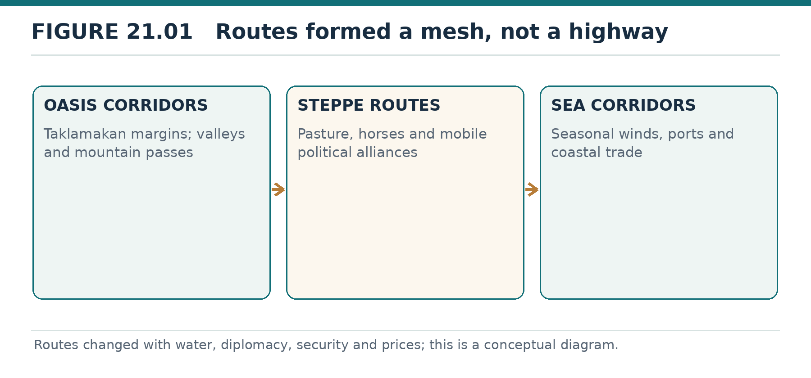

A flat line across a modern map disguises the difficulty of moving across Eurasia. Between northern China and the eastern Mediterranean lie deserts, high mountains, grasslands and fertile river valleys. The <strong>Taklamakan Desert</strong> forced many travelers toward oasis chains around its edges. The Tian Shan, Pamir and Hindu Kush mountains offered passes, but weather and elevation limited when they were usable. Irrigated valleys around places such as Samarkand, Bukhara and Merv supplied food, animals and skilled labor; their ability to sustain travelers depended on water management and political security. The broad steppe belt farther north supported mobile pastoralists whose transport, military and diplomatic roles were central to continental exchange.

There was no permanent, universal “northern route” or “southern route.” Travelers adjusted to dynastic frontiers, a destroyed bridge, a powerful clan, a drought, an outbreak of fighting or the location of trustworthy partners. In some decades a route flourished because a state could offer security; in others merchants shifted to river or maritime passages. A merchant choosing between two paths considered more than kilometers. A longer road with reliable wells and familiar intermediaries might cost less than a shorter one likely to lose animals and cargo.

<strong>Geography constrained choice but did not dictate outcomes.</strong> Desert towns did not become important by desert alone: people invested in canals, walls, markets, shrines, caravan stations and systems of credit and trust. In the same way, seas were neither empty spaces nor automatic barriers. Prevailing winds, harbors, shipbuilding knowledge and coastal commercial communities made them corridors. Geography explains why cooperation was valuable; institutions help explain when that cooperation worked.

<figure class="figure" id="figure-21-1">

<figcaption>Figure 21.1. Routes changed with water, diplomacy, security and prices; this is a conceptual diagram. <a class="figure-anchor" href="#figure-21-1" aria-label="Link to this figure">#</a></figcaption>
</figure>
