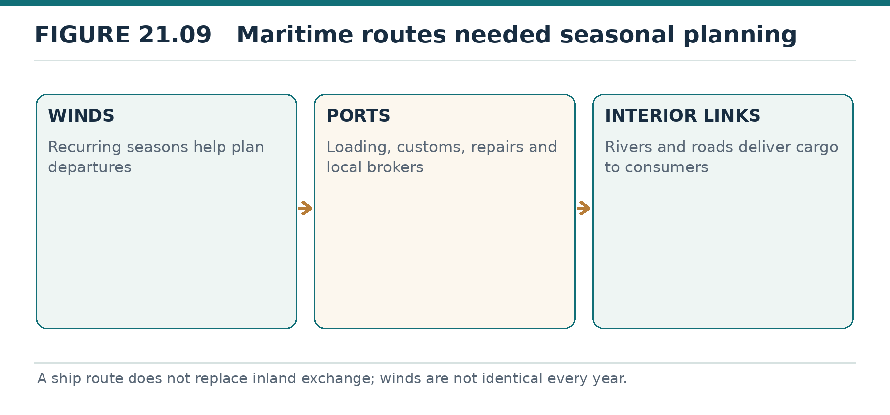

A map focused only on Central Asian caravans gives us an incomplete medieval Eurasia. Maritime networks linked ports around the <strong>Arabian Sea, Persian Gulf, Red Sea, Bay of Bengal and South China Sea</strong>. Sailors exploited recurring seasonal wind patterns, including the Indian Ocean monsoon system, although voyage planning depended on local conditions and knowledge. Merchant communities in ports such as Siraf, Aden and ports on India's coasts exchanged goods and information with East Africa and Southeast Asia. Different routes rose and fell with commercial and political circumstances.

Maritime shipping could move bulkier quantities of many goods more efficiently than pack animals, but this was not a universal law independent of ship size, storms, piracy, port fees and inland transport. A cargo reaching a harbor still needed riverboats, carts or human labor to reach consumers inland. Ships could not simply replace the connections to oasis towns, as many destinations and resources lay far from the coast. <strong>Overland and maritime systems were competitors, alternatives and complements at the same time.</strong>

Stories of sea trade sometimes collapse into a romantic image of a merchant steering straight from Baghdad to China. Actual voyages frequently involved intermediate ports and multiple merchants; some goods traveled farther than the people who first sold them. Maritime archives and shipwrecks tell us about routes, but ships survive unevenly. The <strong>Belitung shipwreck</strong> of the ninth century, discovered near Indonesia, provides striking evidence of pottery and other goods moving across maritime Asia, though its precise itinerary is not fully recoverable from its cargo alone.

<figure class="figure" id="figure-21-9">

<figcaption>Figure 21.9. A ship route does not replace inland exchange; winds are not identical every year. <a class="figure-anchor" href="#figure-21-9" aria-label="Link to this figure">#</a></figcaption>
</figure>
