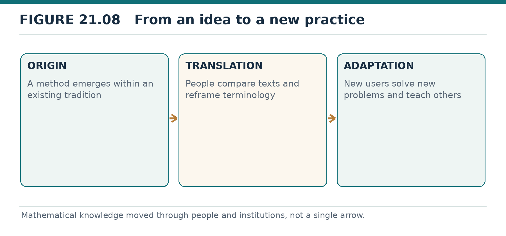

South Asia is too often shown as empty space between China and the Islamic world. In reality, Indian agricultural regions, ports, pilgrimage centers and courts were sources of goods, ideas and skilled travelers. Merchants carried textiles, spices and other commodities in varied routes and quantities. Indian religious and intellectual traditions influenced East and Southeast Asia through complex processes of travel and local adaptation. Buddhist learning drew visitors to centers such as <strong>Nalanda</strong>, whose archaeological and textual record illuminates centuries of educational activity.

Political history was diverse. After the Gupta period, regional states emerged and competed in northern and southern India, and the <strong>Pala dynasty</strong> of eastern India became an important patron of Buddhism. The <strong>Chola</strong> rulers in southern India later developed major temple, agricultural, maritime and military networks, especially in the tenth to thirteenth centuries. Their connections with Southeast Asia show why land routes do not tell the whole story. Not every merchant sailing from an Indian port served the interests of a single kingdom; port cities often connected overlapping commercial communities.

The historical movement of mathematical concepts offers another example of mediated exchange. The place-value decimal system and forms of calculation developed in South Asia and were transmitted, studied and adapted in Arabic-language scholarship before spreading more widely. Calling them “Arabic numerals” in modern European terminology captures one transmission stage, not the full story of invention. A concept's history may involve <strong>origin, translation, modification and adoption</strong> by different people centuries apart.

<figure class="figure" id="figure-21-8">

<figcaption>Figure 21.8. Mathematical knowledge moved through people and institutions, not a single arrow. <a class="figure-anchor" href="#figure-21-8" aria-label="Link to this figure">#</a></figcaption>
</figure>
