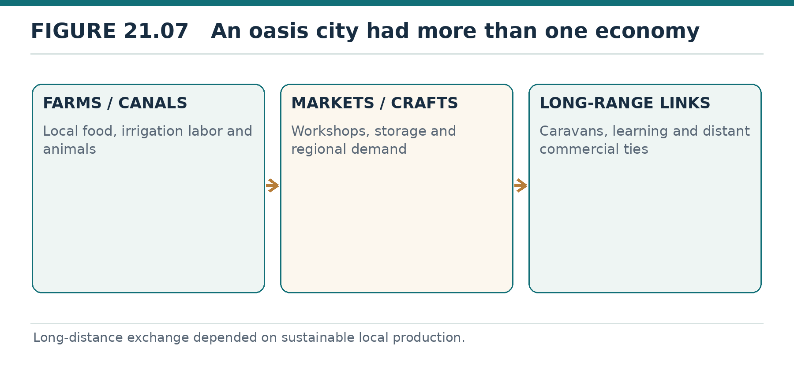

Chapter 20 followed the rise of Islam and the early caliphates. By the ninth and tenth centuries, scholars and merchants could use Arabic across large areas, while Persian, local Iranian languages, Turkic languages and many others remained important. Baghdad was a great intellectual and commercial city, but it was not the single marketplace or cultural center of an otherwise passive world. Basra, Nishapur, Merv, Bukhara, Samarkand, Cairo and many other centers had their own functions. Political fragmentation could coexist with shared legal, literary and commercial networks.

Under the <strong>Samanid dynasty</strong> in Central Asia, especially in the ninth and tenth centuries, Bukhara became a major center of Persianate and Islamic culture. Other regional rulers and trading communities linked Central Asia with Iran, India, the steppe and China. Later <strong>Ghaznavid</strong> and <strong>Seljuk</strong> power reshaped political arrangements across parts of the region. The Seljuks were Turkic-origin rulers whose expansion into Iran and the Middle East altered balances of military power and patronage. The <strong>Karakhanids</strong>, meanwhile, played an important role in the Islamization and political transformation of parts of Inner Asia.

Nothing in this story should imply a universal, instantaneous replacement of pre-Islamic Central Asian culture. Islamization was uneven; language, family and local practice changed over generations. Mosques, religious schools and legal communities offered new kinds of continuity, while cities continued to depend on irrigation and trade. <strong>A change of dynasty could interrupt a tax arrangement without interrupting a language, craft tradition or religious custom.</strong> This distinction is crucial for interpreting the medieval world.

<figure class="figure" id="figure-21-7">

<figcaption>Figure 21.7. Long-distance exchange depended on sustainable local production. <a class="figure-anchor" href="#figure-21-7" aria-label="Link to this figure">#</a></figcaption>
</figure>
