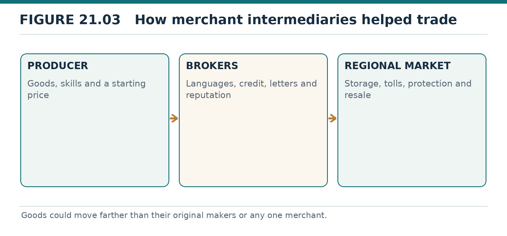

Between the Iranian world and China, Sogdian-speaking communities based around Samarkand and neighboring parts of Central Asia became prominent merchants and cultural intermediaries, particularly from the fourth through eighth centuries. Their diaspora extended into oasis towns and Chinese cities. Families maintained commercial ties, letters and local relationships; some individuals served as interpreters or administrators. These were not a single unified company or an exclusive monopoly. Other Central Asian, Indian, Chinese, Iranian and later Muslim merchants traded alongside and sometimes against them.

Sogdian merchants are a powerful lesson in why <strong>social networks can substitute for distant central enforcement</strong>. If two people use different currencies, laws and languages, a trusted broker can explain weights, arrange storage and vouch for a debtor. Kinship and diaspora ties sometimes supplied confidence that a stranger could not easily provide. But networks also created inequalities between insiders and outsiders. The discovery of Sogdian letters, funerary objects and inscriptions reveals both connections and individual hardship; it does not turn every Sogdian into a wealthy international trader.

The Sogdians also moved stories, images and religious ideas. Some practiced forms of Zoroastrianism, while Sogdian communities participated in Buddhist, Manichaean and Christian traditions as well. Religious identity changed with families, places and generations. Tang-period China adopted Central Asian music, dance and costume elements; foreign-looking figures appear in art and tomb furnishings. Such objects prove fascination and exchange, though they do not tell us that every inhabitant of Chang'an welcomed foreigners. Traders helped produce cosmopolitanism, but political acceptance was conditional.

<figure class="figure" id="figure-21-3">

<figcaption>Figure 21.3. Goods could move farther than their original makers or any one merchant. <a class="figure-anchor" href="#figure-21-3" aria-label="Link to this figure">#</a></figcaption>
</figure>
