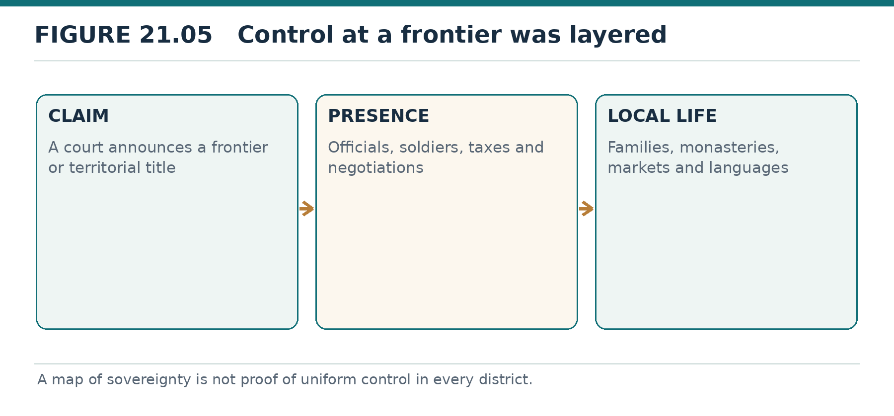

The <strong>Tibetan Empire</strong>, especially from the seventh to ninth centuries, was one of Inner Asia's major states. Tibetan rulers competed and negotiated with Tang China, governed territories across a challenging plateau and controlled some strategically important routes around the Tarim Basin at various times. Their power came from political organization, alliance-building, armies and access to highland networks—not merely from altitude. Tibetan expansion demonstrates that merchants' travel conditions were shaped by rival states whose priorities often had little to do with trade itself.

Tibetan courts also patronized Buddhism, which became an enduring element of Tibetan religious life even as practices and institutions evolved. Buddhist texts moved between languages and regions; translators faced the problem of expressing unfamiliar philosophical vocabulary within new linguistic frameworks. The movement of religious ideas was therefore not a process of simply copying a book. It involved interpretation, teaching, debate, patronage and the creation of new institutions.

Dunhuang passed under Tibetan rule for a substantial portion of the late eighth and ninth centuries, and the surviving multilingual manuscripts reflect overlapping cultural and political worlds. A text written in Tibetan might tell us about translation, official practice, or a local religious community depending on its context. A useful question for any borderland is not simply “Who owned it?” but <strong>“Which authorities could tax, judge, protect, teach or command there, and during which years?”</strong>

<figure class="figure" id="figure-21-5">

<figcaption>Figure 21.5. A map of sovereignty is not proof of uniform control in every district. <a class="figure-anchor" href="#figure-21-5" aria-label="Link to this figure">#</a></figcaption>
</figure>
