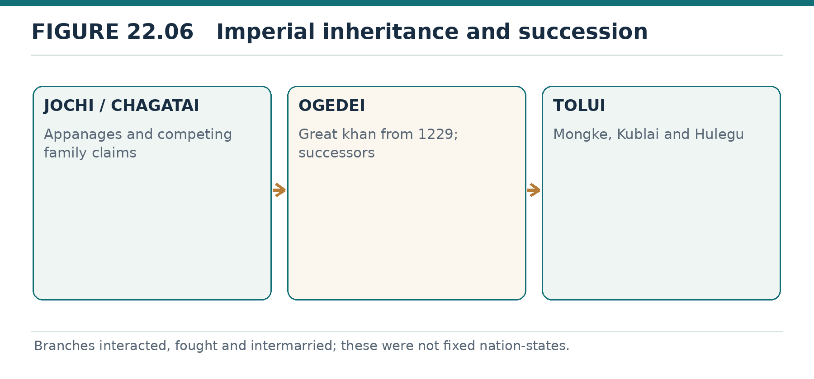

Chinggis Khan's death did not end the Mongol expansion. His descendants inherited territories, military followers and claims associated with different branches of the ruling family. The traditional divisions related to the lines of <strong>Jochi, Chagatai, Ögedei and Tolui</strong> were neither four modern countries nor perfectly fixed borders. The imperial family managed large appanages and overlapping rights while the <strong>great khan</strong> claimed supreme authority. Assemblies and political bargaining determined succession, but competing relatives could contest the result.

<strong>Ögedei</strong> became great khan in <strong>1229</strong> and presided over major new campaigns. The court developed at <strong>Karakorum</strong> in Mongolia, where visiting envoys encountered a political center linked to enormous regions through men and messages. After Ögedei died in <strong>1241</strong>, regencies and succession disputes intensified. <strong>Töregene Khatun</strong>, his widow, exercised authority during a regency, and her decisions shaped elite politics. Later <strong>Sorghaghtani Beki</strong> played a decisive role in the advancement of her sons, among them Möngke and Kublai. The central position of these women is evidence that Mongol power was not simply a chain of male warriors, though their opportunities were conditioned by aristocratic status and dynastic politics.

This family system expanded the empire rapidly but carried a contradiction. The greater the distances between royal courts and the richer the conquered regions, the more incentive local rulers had to keep resources and control succession themselves. <strong>The institutions that made imperial expansion possible could also encourage fragmentation.</strong> We will see that contradiction clearly in the Golden Horde, the Ilkhanate and the Yuan dynasty.

<figure class="figure" id="figure-22-6">

<figcaption>Figure 22.6. Branches interacted, fought and intermarried; these were not fixed nation-states. <a class="figure-anchor" href="#figure-22-6" aria-label="Link to this figure">#</a></figcaption>
</figure>
