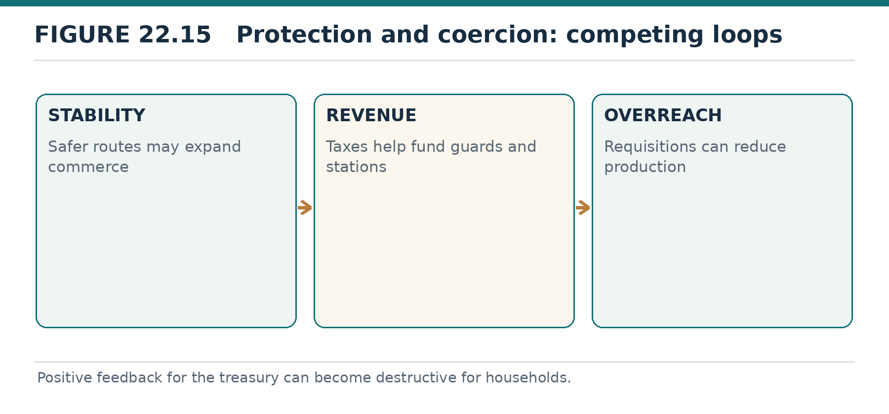

The empire's expansion depended on grasslands, grazing animals, grain-producing regions, taxation and trade. Yet the environments of the Yellow River basin, Central Asian oases, Iranian plateau and western European plains were different. Droughts, harsh winters, agricultural damage, unstable taxation or local resistance could weaken the capacity to support armies and courts. Scholars debate the role of climate in the timing of steppe conquests and later crises; no simple temperature chart proves why a particular khan invaded a city.

The fiscal problem was just as important. Conquerors could seize wealth once, but a long-lived state needed <strong>repeatable revenue</strong>. Excessive requisition could destroy the productive base it hoped to tax. Local administrators had to know households, crops, roads and prices. Corruption or competition among officials could make policy contradictory. A ruler who ordered lower taxes might struggle to enforce it in a province where soldiers demanded supplies.

Think of imperial government as a system with feedback. Successful protection may increase commerce and revenue; greater revenue may finance stations and troops. But demands for more troops can cause requisitions, flight and declining production, eventually weakening the state. <strong>Both reinforcing and damaging loops operated</strong>, and different regions followed different trajectories. This is the systems-thinking lens introduced in Chapter 7 applied to a real historical empire.

<figure class="figure" id="figure-22-15">

<figcaption>Figure 22.15. Positive feedback for the treasury can become destructive for households. <a class="figure-anchor" href="#figure-22-15" aria-label="Link to this figure">#</a></figcaption>
</figure>
