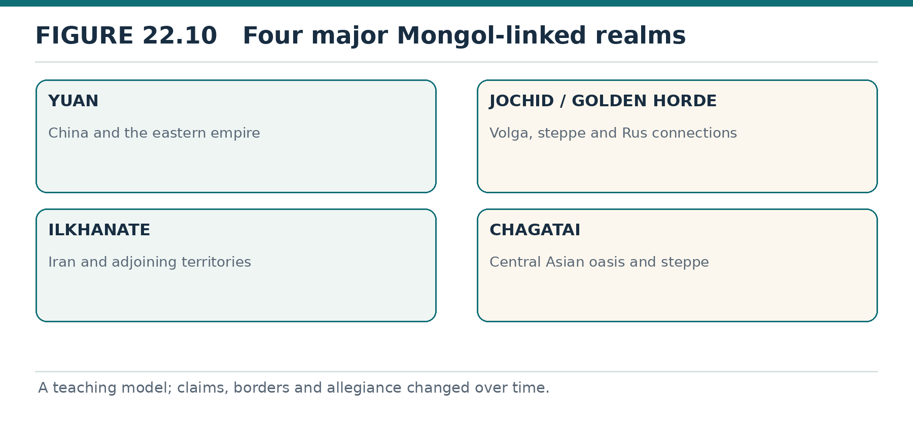

By the later thirteenth century, historians commonly describe four major Mongol-linked power centers: the <strong>Yuan dynasty</strong>, <strong>Ilkhanate</strong>, <strong>Chagatai khanate</strong> and <strong>Jochid/Golden Horde</strong>. This is a useful organizing diagram, not a map of four perfectly separated boxes. Their borders moved, their rulers fought, intermarried or negotiated, and many regional groups held degrees of autonomy. Parts of India, Japan, Southeast Asia and the Middle East remained outside direct Mongol control despite invasion threats or diplomatic relations.

Each realm developed differently because it governed different ecological and social settings. A Yuan emperor depended on Chinese agricultural taxation and metropolitan administration; a Jochid khan negotiated with princes and cities across the steppe and eastern Europe; an Ilkhan worked with Persian fiscal officials and local landholders; Chagatai rulers operated across oasis settlements and pastoral zones. <strong>One Mongol tradition did not produce one universal policy.</strong> Even the language of “empire” can hide differences between possession, tribute, dynastic claims and the ability to enforce decisions.

That divergence makes the later Mongol world more interesting than a rise-and-fall story. Some successor dynasties retained trade connections while fighting one another. Some converted to Islam or increasingly patronized Buddhist traditions. Others adopted different literary languages and court rituals. The original family connection remained politically meaningful, but it did not guarantee harmony. The phrase <strong>Pax Mongolica</strong> is useful only if we ask <em>peace for whom, on which route, and during which decades?</em>

<figure class="figure" id="figure-22-10">

<figcaption>Figure 22.10. A teaching model; claims, borders and allegiance changed over time. <a class="figure-anchor" href="#figure-22-10" aria-label="Link to this figure">#</a></figcaption>
</figure>
