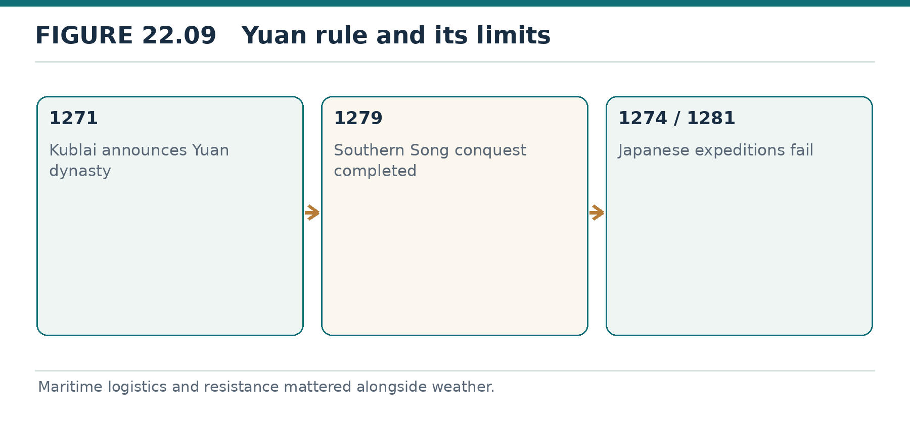

The struggle following Möngke's death in <strong>1259</strong> exposed a major fracture. His brothers <strong>Kublai</strong> and <strong>Ariq Böke</strong> competed for supreme authority; Kublai prevailed after a civil war, but the idea of one great khan commanding every Mongol realm was increasingly unrealistic. Kublai ruled from the Chinese political world and declared the <strong>Yuan dynasty</strong> in <strong>1271</strong>. The Mongols completed their conquest of the Southern Song by <strong>1279</strong>, bringing the whole of China under Yuan rule. The dynastic capital at <strong>Dadu</strong> (modern Beijing) became a center of an empire combining steppe and Chinese institutions.

Yuan government drew on Chinese bureaucratic practice while preserving significant ethnic and status distinctions. The division of society into ranked categories was not perfectly fixed in every setting, but conquest affected access to office, legal standing and privilege. Local officials, administrators from Central and West Asia, merchants and specialists worked within the government. To describe the Yuan simply as “Chinese rulers with Mongol names” misses the imperial court's distinctive political network; to describe it simply as a foreign military camp misses its use of Chinese institutions.

Kublai's ambitions also reached beyond China. Yuan and allied <strong>Goryeo</strong> forces invaded <strong>Japan in 1274 and 1281</strong> but did not secure conquest. Storms helped shape later memory, especially of the second expedition, but Japanese defense, maritime logistics and command difficulties also mattered. In Southeast Asia the Yuan pursued campaigns and diplomacy with mixed outcomes. <strong>An empire optimized for continental movement could not transfer its strengths effortlessly onto every sea.</strong>

<figure class="figure" id="figure-22-9">

<figcaption>Figure 22.9. Maritime logistics and resistance mattered alongside weather. <a class="figure-anchor" href="#figure-22-9" aria-label="Link to this figure">#</a></figcaption>
</figure>
