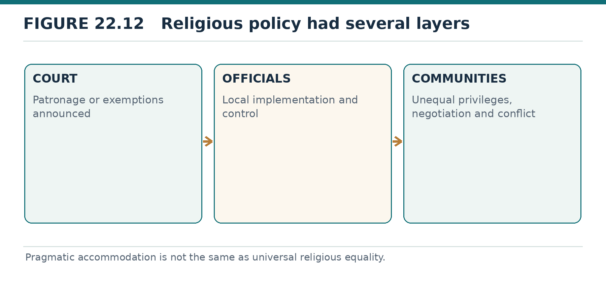

The empire governed Buddhists, Muslims, Christians, Daoists, people participating in diverse local traditions and communities practicing <strong>Tengrist</strong> or related steppe religious traditions. Mongol rulers could patronize several religious institutions at once and recruit clerics or specialists from different faiths. Western visitors, including <strong>William of Rubruck</strong>, encountered religious diversity at Mongol courts. Some local religious leaders received exemptions or privileges; others experienced restrictions, political conflict or the destruction accompanying military campaigns.

The common claim that the Mongols practiced perfect <strong>religious tolerance</strong> is too broad. It is more accurate to say that many rulers adopted <strong>pragmatic religious accommodation</strong>, often making use of competing religious communities to reinforce authority. Policies could change under different khans and across regions. Later Islamic conversion among rulers of the Ilkhanate and Golden Horde did not erase all previous beliefs instantly; it transformed political legitimacy and public institutions over time. In China, court patronage and Tibetan Buddhist connections developed in distinctive ways.

Religious diversity also reveals the challenge of an empire made from different societies. A Muslim merchant in one city, a Buddhist monastic community near another and a Christian envoy at court could all have different experiences of the same dynasty. <strong>The ruler's attitude is not identical to everyday religious life.</strong> Studying the empire requires looking at law, patronage, violence, local autonomy and individual testimony together.

<figure class="figure" id="figure-22-12">

<figcaption>Figure 22.12. Pragmatic accommodation is not the same as universal religious equality. <a class="figure-anchor" href="#figure-22-12" aria-label="Link to this figure">#</a></figcaption>
</figure>
