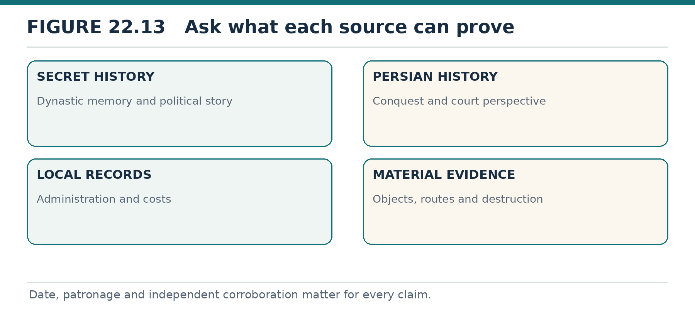

The <strong>Secret History of the Mongols</strong>, composed in the thirteenth century and surviving through a complex manuscript tradition, is a central source for the rise of Temüjin. It preserves genealogies, political memory, speeches and stories of personal loyalty. Those features make it invaluable, but they also warn us that the text serves a dynastic narrative. A heroic speech written into a history cannot automatically be transcribed as the exact words spoken on a battlefield decades earlier.

Persian historians such as <strong>Ata-Malik Juvayni</strong> and <strong>Rashid al-Din</strong> worked under or near Mongol governments. Their texts preserve information unavailable elsewhere, while reflecting their political positions, literary conventions and sources. Chinese bureaucratic accounts, archaeological materials and western travel narratives provide additional vantage points. No single tradition speaks for all peoples under Mongol rule. Sometimes two authors repeat the same story because one copied the other: agreement between dependent sources is not independent confirmation.

Apply a four-part audit: <strong>date and proximity</strong>, <strong>purpose and patronage</strong>, <strong>kind of claim</strong>, and <strong>independent cross-check</strong>. A chronicle may be strong evidence that a ruler sought legitimacy but weak evidence for the exact number killed in a distant city. A tax document may be strong evidence for an assessed obligation while telling us little about whether it was actually collected. Reading medieval history means thinking about evidence <strong>at the same time</strong> as the narrative, not after it.

<figure class="figure" id="figure-22-13">

<figcaption>Figure 22.13. Date, patronage and independent corroboration matter for every claim. <a class="figure-anchor" href="#figure-22-13" aria-label="Link to this figure">#</a></figcaption>
</figure>
