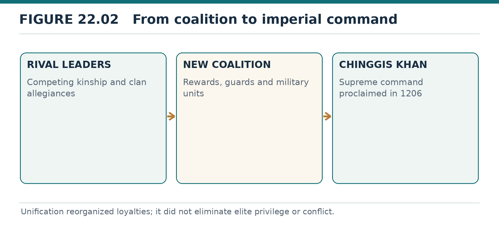

In <strong>1206</strong>, after defeating important rivals, Temüjin was acclaimed <strong>Chinggis Khan</strong> at an assembly or <em>quriltai</em>. The title, whose precise interpretation is debated, marked a new political claim: leadership not merely of a band of companions but of a wider community of peoples and rulers. The date is a useful starting point for the Mongol Empire, even though the institutions that sustained it evolved during subsequent decades. The famous phrase <em>largest contiguous land empire</em> describes the imperial system at its greatest expansion under his successors, not the territory personally conquered in 1206.

An imperial claim required mechanisms. Households and military groups were reorganized; selected men formed a royal guard; commanders commanded units arranged in conventional decimal groupings; envoys carried orders across great distances. Later authors sometimes describe a single comprehensive legal code called the <em>Great Yasa</em>. Yet the surviving evidence does not justify imagining a modern statute book containing every supposedly Mongol rule. Royal commands, customs and later recollections have been bundled together in ways scholars continue to investigate.

The new order combined intimate loyalty with formidable coercion. Conquered peoples could supply warriors, artisans, animals, tax revenue and logistical services. Successful commanders might become powerful through service, but wealth and rank remained politically contested. <strong>Institution-building did not make the empire peaceful</strong>. It made organized expansion possible and gave rulers methods for channeling conquest into enduring authority—methods that would later be adapted very differently in China, Iran and the western steppe.

<figure class="figure" id="figure-22-2">

<figcaption>Figure 22.2. Unification reorganized loyalties; it did not eliminate elite privilege or conflict. <a class="figure-anchor" href="#figure-22-2" aria-label="Link to this figure">#</a></figcaption>
</figure>
