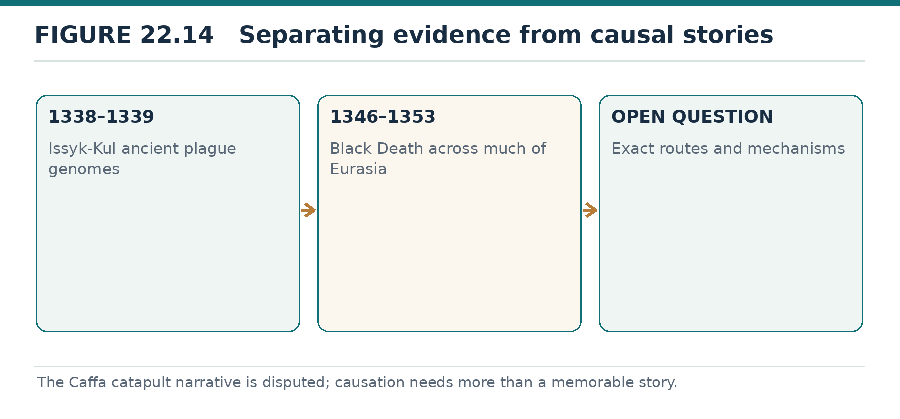

The Mongol era's long-distance connections intersected with one of the greatest demographic disasters in history. The <strong>Black Death</strong> reached much of Europe, the Middle East and North Africa in the mid-fourteenth century, while earlier plague outbreaks occurred elsewhere. The disease involved <strong>Yersinia pestis</strong>, a bacterium with ecological reservoirs and pathways that are still studied. A 2022 ancient-DNA study found plague evidence at burial sites near <strong>Lake Issyk-Kul</strong> in present-day Kyrgyzstan dated to <strong>1338–39</strong>, providing important evidence about the ancestry of strains associated with the later pandemic.

It is tempting to draw a simple arrow—“Mongols connected Eurasia, therefore the Mongols caused the Black Death.” That statement overreaches. Political connections, movement of people and goods, ecological conditions and routes of disease transmission are linked, but the details differ across places. Contested older narratives describe plague-infected corpses being catapulted into the Genoese settlement of <strong>Caffa</strong>. The celebrated story relies heavily on a non-eyewitness account and is not a secure explanation for the pandemic's spread. Historians have shown that Black Sea trade, embargoes and chronology make the simple tale inadequate.

<strong>Connectivity produces risks as well as benefits.</strong> Roads and ports do not choose to transmit manuscripts instead of pathogens. The analytical task is to reconstruct mechanisms rather than claim one empire engineered a natural disaster. Even where causal pathways remain debated, the catastrophe reminds us that the historical meaning of an exchange network depends on what moves through it.

<figure class="figure" id="figure-22-14">

<figcaption>Figure 22.14. The Caffa catapult narrative is disputed; causation needs more than a memorable story. <a class="figure-anchor" href="#figure-22-14" aria-label="Link to this figure">#</a></figcaption>
</figure>
