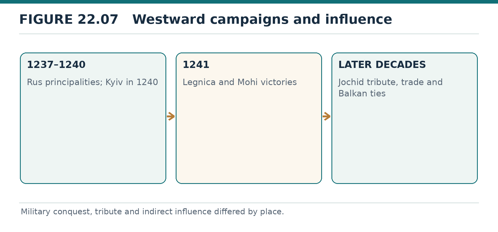

Mongol forces advanced against the <strong>Volga Bulgars</strong> and the <strong>Rus' principalities</strong> during the campaigns associated with <strong>Batu</strong>, a descendant of Jochi, and the commander <strong>Sübedei</strong>. They captured or destroyed numerous towns and defeated divided princely armies; <strong>Kyiv fell in 1240</strong>. The campaign was not against a unified nation-state called Russia, which did not exist in its modern form. Rus' communities and rulers had different interests, and their relationships with the new Mongol power continued to evolve.

In <strong>1241</strong>, Mongol armies defeated forces at <strong>Legnica</strong> in Poland and at <strong>Mohi</strong> in Hungary. The western advance generated fear across Europe. Campaigning forces withdrew from Hungary in 1242, but the explanation is contested. Ögedei's death in December 1241 and succession politics mattered, yet historians also examine local resistance, terrain, supplies, weather and broader strategic objectives. It is too simple to say one death automatically saved Europe. Nor is it correct that Mongols were technologically incapable of moving through Europe; they had already demonstrated dangerous operational reach.

For southeastern Europe, the effects reached beyond battlefields. Mongol expeditions and later western steppe politics influenced the <strong>Second Bulgarian Empire</strong> and neighboring polities through raids, tribute pressures, diplomacy and the power of leaders such as <strong>Nogai</strong>. The precise chronology and degree of dependence varied. It would be misleading to imagine a single unchanging Mongol administration governing every Balkan village. The region's experience shows what <strong>imperial influence without uniform direct occupation</strong> could look like.

<figure class="figure" id="figure-22-7">

<figcaption>Figure 22.7. Military conquest, tribute and indirect influence differed by place. <a class="figure-anchor" href="#figure-22-7" aria-label="Link to this figure">#</a></figcaption>
</figure>
