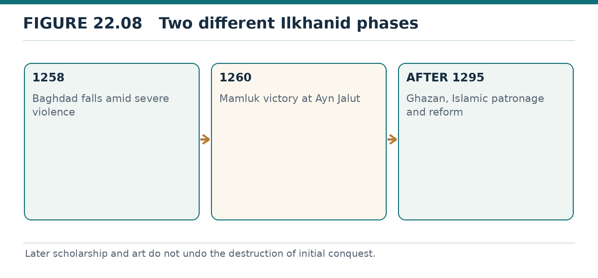

Under <strong>Möngke Khan</strong>, who became great khan in <strong>1251</strong>, new campaigns were organized across different fronts. His brother <strong>Hülegü</strong> advanced west, overcoming major Nizari Ismaili strongholds and moving against the Abbasid caliphate. In <strong>1258</strong>, Mongol forces besieged and captured <strong>Baghdad</strong>. The city suffered violence and destruction; the Abbasid caliph was killed, bringing an end to the Baghdad-based Abbasid caliphate as a ruling institution. Popular retellings tell of books turning the Tigris black with ink. Such imagery captures catastrophe but should not be mistaken for a measured, independently verified account of every library's fate.

Hülegü's successors established the <strong>Ilkhanate</strong>, centered largely in Iran and neighboring regions. Its rulers relied heavily on Persian officials, local tax systems and skilled urban communities. Control was not uniform, and relations with the Golden Horde and Mamluk Egypt produced repeated conflict. The Mongol advance in Syria met a decisive defeat by the <strong>Mamluks at Ayn Jalut in 1260</strong>. That battle did not eliminate Mongol power in Iran; it demonstrated that further expansion could be resisted and that regional wars had their own political and logistical limits.

By the late thirteenth century, Ilkhanid rulers adopted and patronized traditions rooted in the societies they governed. <strong>Ghazan</strong>, who came to power in <strong>1295</strong>, converted to Islam and introduced important reforms. Court art and history writing flourished; the illustrated chronicles of <strong>Rashid al-Din</strong> are among the period's most significant cultural products. The same dynasty was thus both an agent of conquest and a participant in Persianate and Islamic civilization. Calling it either an entirely alien occupation or an uncomplicated cultural renaissance would conceal essential evidence.

<figure class="figure" id="figure-22-8">

<figcaption>Figure 22.8. Later scholarship and art do not undo the destruction of initial conquest. <a class="figure-anchor" href="#figure-22-8" aria-label="Link to this figure">#</a></figcaption>
</figure>
