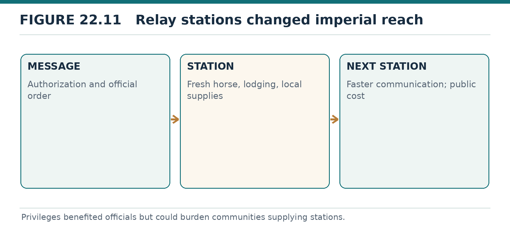

Rulers of scattered territories face a central problem: orders are useless if they arrive after events have changed. The Mongol state developed and expanded a <strong>relay-post network</strong>, usually called the <em>yam</em> or <em>jam</em>, with stations supporting authorized messengers. Horses, supplies and accommodations could make communication faster over long distances. Travel permissions, sometimes represented by tablets or credentials known as <strong>paiza</strong>, helped identify people entitled to use imperial facilities. In some regions these arrangements built on older practices rather than appearing from nothing.

The relay network was not a public postal service freely open to everyone. It imposed costs on communities required to provide animals and supplies, and the system could be misused by elites. The fact that a diplomatic message could move quickly tells us little about whether an ordinary peasant received the same protection. Officials and merchants sometimes benefited from more predictable routes, but warfare, theft and local power still constrained travelers. Systems varied across the khanates and across generations.

A <strong>hypothetical calculation</strong> illustrates the potential difference. If a messenger can change horses and average 120 kilometers per day, a 1,200-kilometer message route would take <strong>10 days</strong>. An individual party averaging 40 kilometers per day would need <strong>30 days</strong>, excluding stops. These are teaching assumptions, not historical performance averages. The lesson is about <strong>how infrastructure converts public resources into administrative reach</strong>—and why its benefits and burdens were distributed unequally.

<figure class="figure" id="figure-22-11">

<figcaption>Figure 22.11. Privileges benefited officials but could burden communities supplying stations. <a class="figure-anchor" href="#figure-22-11" aria-label="Link to this figure">#</a></figcaption>
</figure>
