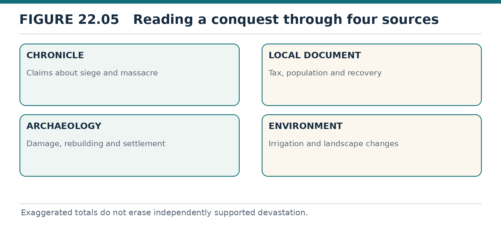

The <strong>Khwarazmian Empire</strong> controlled much of Central Asia and Iran when the Mongols approached its frontiers. Merchants, envoys and rulers operated in a sensitive space where trade and diplomacy overlapped. Accounts commonly link the war to the seizure or killing of a Mongol-connected merchant caravan at <strong>Otrar</strong> and the subsequent mistreatment of envoys. The episode mattered, but sources differ on details and responsibility; the invasion also occurred in the context of an expanding imperial strategy.

Beginning in <strong>1219</strong>, Mongol armies attacked the Khwarazmian realm. Cities including <strong>Bukhara</strong> and <strong>Samarkand</strong> fell; campaigns and sieges devastated settlements across the region. A later phase involved campaigns in Khurasan and elsewhere, while pursuing armies advanced astonishing distances westward. Chroniclers record mass slaughter, forced displacement, destruction of infrastructure and the loss of urban populations. Some narratives give enormous death totals that cannot be treated as reliable counts. Uncertain numbers do not make the suffering imaginary: repeated, independent evidence establishes that the conquest was profoundly destructive.

Why were cities vulnerable? Political division, rival commanders, difficult communications and Mongol operational coordination mattered alongside walls and troop strength. Yet a defeated city did not always experience the same fate: choices about resistance, negotiations, local leaders and a commander’s aims affected outcomes. <strong>History is not well served by a single formula</strong> that says the Mongols always massacred opponents or always spared those who surrendered. The general threat of violence was real, but events varied. The transformation of these cities provides a crucial counterweight to later stories of flourishing Eurasian trade.

<figure class="figure" id="figure-22-5">

<figcaption>Figure 22.5. Exaggerated totals do not erase independently supported devastation. <a class="figure-anchor" href="#figure-22-5" aria-label="Link to this figure">#</a></figcaption>
</figure>
