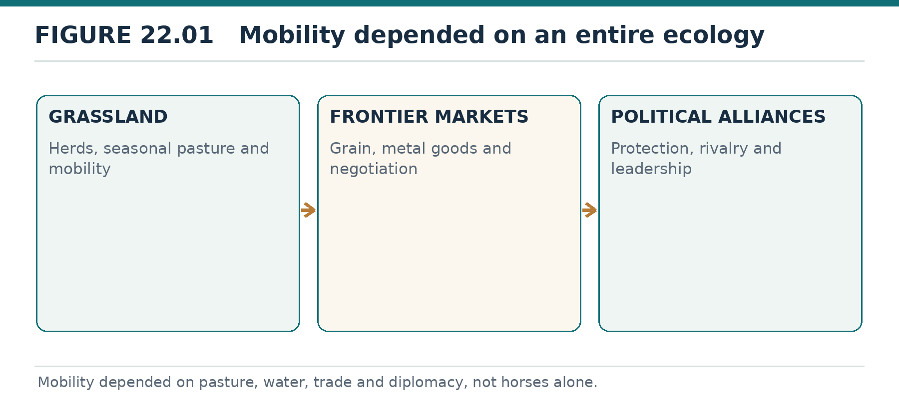

The eastern Eurasian steppe includes large grassland areas, mountain edges, rivers and zones bordering forests and deserts. Many households practiced <strong>pastoralism</strong>, depending on herds for food, materials, transport and exchange. Movement between seasonal pastures was a form of environmental knowledge, not evidence that people lacked settled institutions or cultural life. Horses mattered because they offered speed and endurance across landscapes where carts, foot soldiers and agricultural armies faced severe constraints. Yet people also required dependable access to water, fodder, political allies and markets for goods they did not produce themselves.

The steppe was not one nation. Around Temüjin's youth, different communities—including Mongol, Kereit, Naiman, Merkit and Tatar groups—formed shifting alliances and fought over grazing land, captives, prestige and trade. Some were connected to states such as the Jurchen-led <strong>Jin dynasty</strong> of northern China. Local rulers could reward allied steppe leaders, restrict trade or support rivals. The boundary between nomadic and settled societies was consequently a field of negotiation rather than an uncrossable wall. A Mongol ruler might depend on a Chinese market for metal goods just as a frontier government might rely on steppe horses.

A map that colors the steppe as empty disguises its dense political geography. Winter conditions could threaten herds; drought might create competition; marriage alliances might decide whether a family survived. <strong>Mobility was an advantage, not limitless freedom.</strong> If an army lost access to pasture or ran into fortified walls and bad logistics, mounted skill alone could not secure victory. Keep this balance in mind when we encounter celebrated cavalry campaigns: their success involved organization and knowledge as much as horses.

<figure class="figure" id="figure-22-1">

<figcaption>Figure 22.1. Mobility depended on pasture, water, trade and diplomacy, not horses alone. <a class="figure-anchor" href="#figure-22-1" aria-label="Link to this figure">#</a></figcaption>
</figure>
