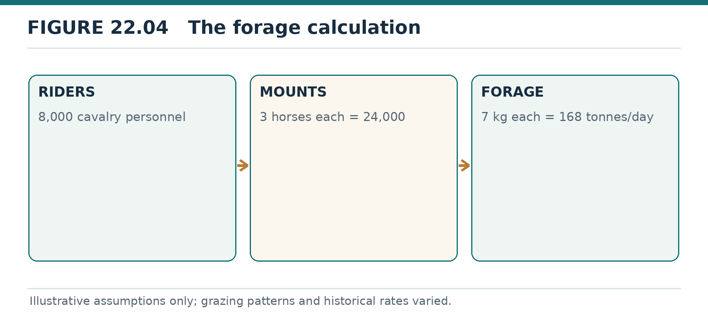

A campaigning force required far more than courage. Horses need pasture or feed, men need food and water, and an army must carry equipment while avoiding exhaustion. A mounted unit traveling across a grassland could obtain some resources locally; the same unit in winter, a devastated valley, a crowded route or near a walled city might struggle. Camps, herds, scouts, families, captives and specialists did not all travel at one speed. Commanders had to plan who moved, where supplies were found, and when an approach became unsustainable.

Consider a <strong>hypothetical arithmetic example</strong>, not a reconstruction of a specific Mongol army. Suppose 8,000 riders have three horses each. That is 24,000 horses. If each horse requires an average of 7 kilograms of edible forage per day, the animals together need 168,000 kilograms—<strong>168 metric tonnes daily</strong>. Actual requirements and pasture intake vary, and grazing animals do not necessarily carry this forage as packed cargo. The exercise nevertheless reveals why route selection, seasons, animal condition and dispersed movement mattered. Numbers turn a vague word such as <em>logistics</em> into a physical constraint.

A second constraint was information. A ruler who knows the location of rivers and roads but not the politics of the next city may lose troops in a siege. Mongol forces gathered intelligence from merchants, surrendered officials and envoys. They could demand submission in advance, threatening terrible consequences for resistance. Such threats were instruments of warfare and political domination, not neutral communication. <strong>Strategic efficiency and deliberate terror coexisted.</strong> Understanding a mechanism does not excuse the suffering it caused.

<figure class="figure" id="figure-22-4">

<figcaption>Figure 22.4. Illustrative assumptions only; grazing patterns and historical rates varied. <a class="figure-anchor" href="#figure-22-4" aria-label="Link to this figure">#</a></figcaption>
</figure>
