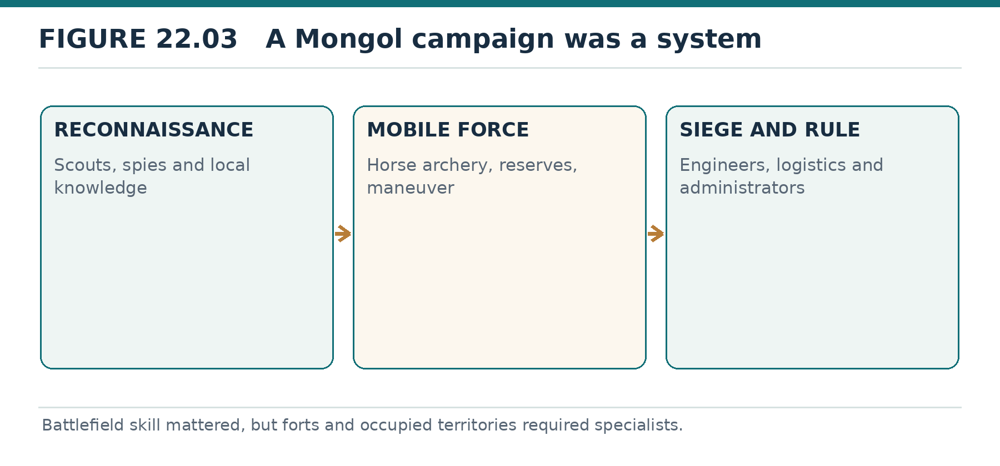

The popular image is of a horse archer racing across open grassland. Mounted archery was crucial, especially when riders could choose distance, maneuver around opponents or execute a planned retreat. A fighter might manage more than one mount, permitting changes of horse during prolonged movement. Commanders used scouts, reconnaissance, coordinated wings, deception and campaigns that attacked the enemy's allies or communications. High mobility also gave armies opportunities to <strong>concentrate force at a chosen place</strong> before a slower opponent could react.

But the Mongol military system was more diverse than a cavalry stereotype. It absorbed engineers, siege crews, infantry, local guides and specialists from conquered societies. Against strongholds, armies could build siege equipment, block roads, divert water or negotiate surrender. Against maritime targets, especially later under the Yuan, conquest required ships, sailors and an unfamiliar set of skills. No army was invincible, and the same tactics were not equally effective in every terrain or political environment.

Military historians distinguish a convincing explanation from a heroic legend. We have evidence for composite bows, armor, disciplined organization and siege technology. We do <strong>not</strong> have reliable precision for every army size or casualty number in medieval chronicles. If a source claims an implausibly huge mounted force crossed a dry region, ask about forage and water: a horse consumes resources every day, and a large army with multiple mounts rapidly becomes a moving ecological problem. This simple logistical question is often more useful than the image of an unstoppable horde.

<figure class="figure" id="figure-22-3">

<figcaption>Figure 22.3. Battlefield skill mattered, but forts and occupied territories required specialists. <a class="figure-anchor" href="#figure-22-3" aria-label="Link to this figure">#</a></figcaption>
</figure>
