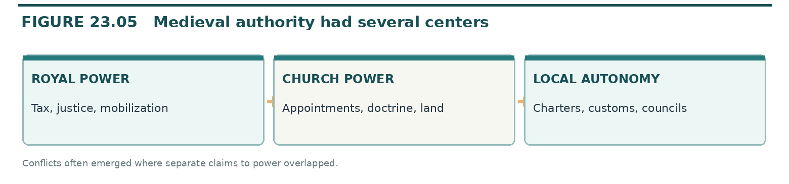

Christianity structured much of medieval public life, yet no single church or ruler commanded all Christian societies. In Latin Europe, bishops, monasteries, parish communities and the papacy cultivated institutions for worship, education, law, charity and property holding. Church leaders could negotiate with kings over the appointment of bishops, jurisdiction and revenue. Conflicts commonly grouped under the Investiture Controversy demonstrate that political and religious authority were intertwined but not identical. A ruler sought loyal administrators; reforming churchmen asserted the independence and spiritual powers of ecclesiastical offices.

In Constantinople, emperors protected and sometimes intervened in church affairs, while patriarchs, monastic leaders and bishops possessed their own authority. Calling the Eastern church an emperor's department would be inaccurate: its theology, canon law, monastic networks and internal disputes could constrain emperors as well as serve them. Nor should the medieval Latin church be described as a purely spiritual organization: it owned property, governed courts and maintained international networks. Jewish communities, Muslim institutions and religious minorities encountered different legal and social situations depending on city, dynasty and moment.

The relationship between church and state was therefore a negotiation over personnel, law, property and legitimacy. Historians should separate doctrine, political claims, institutional practice and the experiences of ordinary believers. One lesson for the whole book is that medieval religion did not operate only in private life; it helped define public authority, calendars, education, welfare, group boundaries and the grounds on which rulers could be challenged.

<figure class="figure" id="figure-23-5">

<figcaption>Figure 23.5. Conflicts often emerged where separate claims to power overlapped. <a class="figure-anchor" href="#figure-23-5" aria-label="Link to this figure">#</a></figcaption>
</figure>
