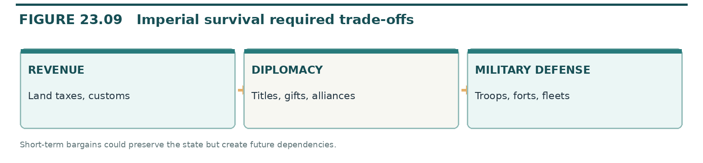

Byzantine survival owed much to institutions capable of collecting revenue, equipping armies and responding to changing frontiers. Land taxes, customs duties and court resources underwrote a bureaucracy, diplomacy and military forces. Soldiers could be recruited or supported through different regional arrangements, and military organization altered repeatedly over time. The term theme is often used for provincial districts and military organization, but one should not imagine that all themes worked identically for centuries. The empire also employed foreign troops, allies and specialized professionals.

Bureaucratic records, laws and ceremonial texts reveal a government intensely concerned with rank, obligation and legitimacy. Legal continuity mattered; emperors represented themselves as guardians of an orderly Christian Roman community. Yet formal rules did not prevent court coups, aristocratic competition or local resistance. Provincial elites accumulated land and power, sometimes creating tension with the fiscal basis of the state. Diplomacy used gifts and titles not because Byzantine officials were cowardly but because purchasing peace or alliance could cost less than fighting a dangerous war.

Consider a hypothetical frontier. A military commander wants more men; a tax official worries that requisition will empty farms; the emperor fears that a neighboring power will ally with an internal rival. A policy that appears weak on a battle map may prove rational when treasury, manpower and politics are considered together. This combination of sophisticated administration and recurring instability is central to understanding how the empire endured until 1453 and why it occasionally suffered catastrophic losses.

<figure class="figure" id="figure-23-9">

<figcaption>Figure 23.9. Short-term bargains could preserve the state but create future dependencies. <a class="figure-anchor" href="#figure-23-9" aria-label="Link to this figure">#</a></figcaption>
</figure>
