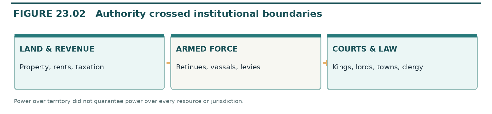

Picture a school diagram with a king at the top, nobles beneath him, knights below them and peasants at the base. It makes medieval society look like a simple pyramid. Yet the famous formula called feudalism has become controversial among historians because relationships of landholding, military service, tenancy and jurisdiction differed so greatly between regions and centuries. A fief might support military service; an oath could bind particular people; a bishop or monastery might hold powers usually assigned to nobles; and royal officers sometimes bypassed local magnates. None of this formed one universal European constitution.

Instead, ask who possessed three concrete things: land and revenue; armed force; and authority to judge disputes. The answer could be different in the same district. In an English county, royal courts and sheriffs might reach farther than in a fragmented principality elsewhere. Within the Holy Roman Empire, imperial authority was negotiated with princes, bishops and cities. In parts of France, Capetian kings gradually extended direct control from a relatively narrow domain. Lords were powerful not because the king had handed out every acre in a single orderly chain, but because property, custom, personal obligations and military resources created uneven power.

Historians also distinguish vassalage, a personal relationship of loyalty and reciprocal obligation, from manorial arrangements connecting landlords and agricultural households. Some peasants were legally unfree; others possessed negotiated rights and degrees of mobility. The model of a perfectly fixed hierarchy misses conflict, courts, petitions, bargains and changes over time. When you see the word feudal, ask the author precisely what it means, where it applies and what sources demonstrate it.

<figure class="figure" id="figure-23-2">

<figcaption>Figure 23.2. Power over territory did not guarantee power over every resource or jurisdiction. <a class="figure-anchor" href="#figure-23-2" aria-label="Link to this figure">#</a></figcaption>
</figure>
