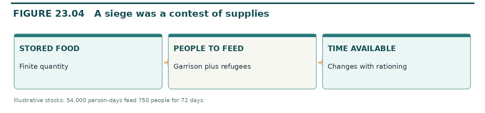

Medieval battle scenes foreground armor and personal bravery, but sustained power depended on recruiting, feeding and paying people. Mounted warriors could deliver shock in some settings; infantry with spears, crossbows, bows and eventually increasingly effective missile weapons also mattered. Field armies were not interchangeable: a force successful on open terrain could struggle against fortified passes or long sieges. Fortresses controlled roads, crossings, storage and political centers. They were investments in stone, labor, water supply, food and soldiers, not magical obstacles that resisted indefinitely.

A siege could end through assault, negotiation, relief by an allied army, betrayal, starvation or disease. Besiegers consumed supplies while attempting to cut off the defenders' supplies. Local civilians paid a price through requisition, crop destruction and displacement. In frontier regions, small garrisons and seasonal raids sometimes mattered more to everyday life than celebrated battles. Castle architecture itself changed in response to new siege methods and the available resources of rulers. Defensive systems became especially costly when artillery matured, but guns did not immediately make walls irrelevant: earthworks, repairs, engineers and protected positions changed the balance repeatedly.

Consider a fictional example. A garrison stores food for 600 people for 90 days: that represents 54,000 person-days before accounting for waste or different rations. If 300 refugees enter and no supplies arrive, the simple arithmetic cuts the duration to 60 days. Reality is messier, but the exercise demonstrates why commanders had to consider civilians, consumption and access to water. Good military history connects weapons to labor, fiscal capacity and choices faced by noncombatants.

<figure class="figure" id="figure-23-4">

<figcaption>Figure 23.4. Illustrative stocks: 54,000 person-days feed 750 people for 72 days. <a class="figure-anchor" href="#figure-23-4" aria-label="Link to this figure">#</a></figcaption>
</figure>
