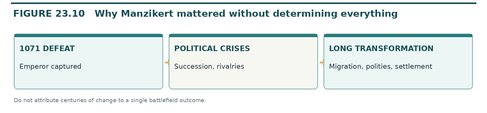

In 1071 Byzantine forces under Romanos IV Diogenes were defeated by a Seljuk army led by Alp Arslan at Manzikert in eastern Anatolia. The emperor was captured and later released. Textbooks often present the event as the single battle that caused Byzantium to lose Anatolia and inevitably brought the Ottoman conquest centuries later. That compresses a complex process into a dramatic but misleading arrow. Manzikert weakened political stability and prestige, but internal struggles, regional military decline, shifting alliances, migration, raids and the emergence of Turkish-led polities mattered greatly in the following years.

Turkic settlement and Islamization in Anatolia did not happen overnight or in a uniform manner. Local Christian communities, Greek-speaking towns, Armenian populations, Muslim newcomers and multiple rulers interacted over generations. The Seljuk sultanate of Rum established power in parts of the peninsula, alongside other Turkish, Byzantine and local political structures. By the late eleventh century, the Byzantines sought help from the west, but western expeditions served agendas that were never fully subordinate to imperial aims.

The historian's task is to connect military defeat with the conditions that translated it into political transformation. Why was the empire unable to reverse some losses? How did succession crises affect recruitment and command? Which districts remained under which authorities? A battlefield can reveal a weakness while not itself causing every consequence attributed to it. Manzikert is important precisely because its afterlife became part of political identity and historical argument far beyond 1071.

<figure class="figure" id="figure-23-10">

<figcaption>Figure 23.10. Do not attribute centuries of change to a single battlefield outcome. <a class="figure-anchor" href="#figure-23-10" aria-label="Link to this figure">#</a></figcaption>
</figure>
