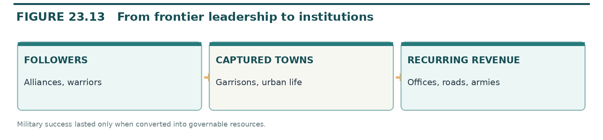

The Ottoman dynasty takes its name from Osman, conventionally called Osman I, whose leadership belongs around the turn of the fourteenth century. The sources for his early life are sparse, and later chronicles contain origin legends crafted when the dynasty was already powerful. One influential tradition depicts a dream predicting immense rule; it tells us much about later ideals of dynastic legitimacy, but little that can be independently verified about Osman's sleeping mind. Historians debate the roles of frontier warfare, Muslim warrior identities, alliances, tribal networks, economic opportunity and recruitment among diverse populations.

The encounter commonly known as the battle of Bapheus in 1302 is an important marker of expanding Ottoman military activity near Byzantine territory, but it should not be treated as the exact instant an empire suddenly appeared. What we can infer more confidently is that Osman's successors were positioned to take advantage of weakening Byzantine authority and competing Anatolian powers. They attracted followers by distributing benefits, offering leadership and pursuing campaigns that increased access to settlements and revenues.

The term ghazi, associated with a warrior of the faith or frontier warrior, appears in historical discussions of the early dynasty. Whether ghaza alone explains Ottoman expansion is contested. Warriors' choices may mix devotional commitments with personal loyalty, the search for booty, local politics and the prospect of land or office. A careful history leaves room for conviction while refusing the idea that a single slogan determines every action. The Ottoman emergence is better understood as the growth of an adaptable political network than as the fulfillment of a predestined founding legend.

<figure class="figure" id="figure-23-13">

<figcaption>Figure 23.13. Military success lasted only when converted into governable resources. <a class="figure-anchor" href="#figure-23-13" aria-label="Link to this figure">#</a></figcaption>
</figure>
