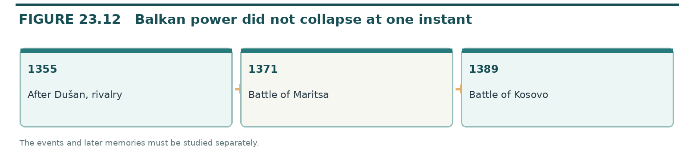

Serbian rulers expanded their influence in the medieval Balkans, often competing and negotiating with Byzantium, Bulgaria, Hungary and one another. Under Stefan Dušan in the fourteenth century, Serbian power reached a striking territorial scale and imperial claims were advanced. But the state was not an immutable national block. Its ruling families managed varied regions, churches, aristocratic interests and legal traditions. Dušan's law code provides evidence of political ambition, social regulation and legal thought, but like any law code it must be compared with actual practice.

After Dušan's death in 1355, competing regional rulers became more prominent. The battle of the Maritsa in 1371 was a major Ottoman victory over forces led by Serbian magnates, contributing to the shifting balance in the central Balkans. The battle of Kosovo in 1389 has acquired exceptionally powerful national and religious meanings in later memory. The historical battle involved a complex coalition of forces; both Sultan Murad I and Prince Lazar died, and the immediate political outcome should not be confused with later epic narratives of heroic sacrifice and national destiny. Ottoman consolidation occurred through later campaigning, negotiations and relationships of dependence, not one instantaneous disappearance of every Serbian polity in 1389.

Historians examine chronicles, Ottoman records, inscriptions and the later transmission of epic traditions. A poem composed generations later may be excellent evidence for what a community remembered and valued, while remaining inadequate proof of the exact words spoken on the battlefield. The distinction between event and memory protects both historical inquiry and the legitimate study of cultural identity. It also makes regional history less vulnerable to modern claims that medieval borders determine present political rights.

<figure class="figure" id="figure-23-12">

<figcaption>Figure 23.12. The events and later memories must be studied separately. <a class="figure-anchor" href="#figure-23-12" aria-label="Link to this figure">#</a></figcaption>
</figure>
