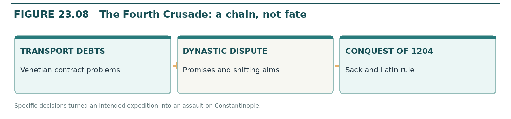

The Fourth Crusade was originally intended to confront Muslim power in the eastern Mediterranean, with Egypt central to its planning. Financing the expedition was difficult. Crusaders contracted with Venice for transport and accumulated obligations they struggled to meet. The enterprise was diverted first toward Zara, a Christian city on the Adriatic, and then became involved in a Byzantine dynastic dispute. Promises of payment, military assistance and church union created incentives that commanders could not reliably fulfill. In April 1204 the crusading army seized and sacked Constantinople, one of the great Christian cities of the world.

This was no simple accident caused by one greedy merchant or one faith's timeless hatred of another. Venetian commercial interests, Latin leadership decisions, Byzantine succession conflicts, financial pressure, mutual suspicion and the collapse of negotiations all played parts. Nor was it an unavoidable result of theology. Specific leaders took decisions in circumstances where alternatives existed. The ensuing Latin Empire controlled Constantinople, while Byzantine successor governments developed at Nicaea, Epirus and Trebizond and Latin principalities took other territories. The balance of force in the Aegean and Balkans was transformed.

The destruction, removal of artworks and political dislocation damaged Byzantine institutions and deepened distrust between Latin and Orthodox Christians. The loss mattered far beyond physical wealth: imperial legitimacy, church jurisdiction, naval access and tax income were all contested. A historian should explain the chain of decisions rather than turn 1204 into evidence that an entire religion or civilization was uniformly hostile to another.

<figure class="figure" id="figure-23-8">

<figcaption>Figure 23.8. Specific decisions turned an intended expedition into an assault on Constantinople. <a class="figure-anchor" href="#figure-23-8" aria-label="Link to this figure">#</a></figcaption>
</figure>
