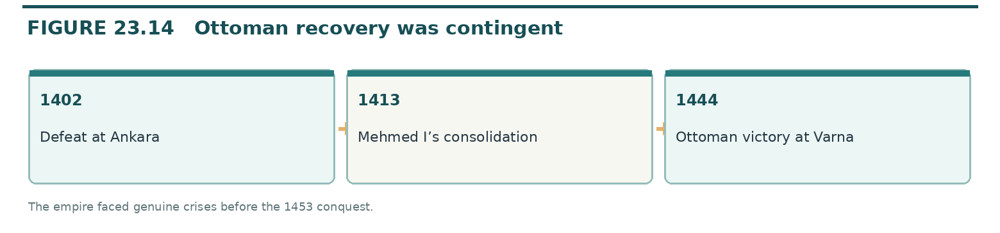

Ottoman expansion was impressive, but not inevitable. In 1402 Timur defeated Bayezid I at the battle of Ankara, and Bayezid was captured. The defeat disrupted Ottoman power and contributed to a struggle among Bayezid's sons, commonly called the Ottoman Interregnum. Competing princes relied on regional military supporters, local elites and allies in both Anatolia and the Balkans. Some territories and rivals regained room for maneuver. A later empire that seemed permanent could still fracture dramatically when succession and military fortune changed.

Mehmed I re-established central dynastic leadership in 1413. His successor Murad II consolidated and expanded Ottoman authority during renewed struggles in the Balkans and Anatolia. In 1444 forces led by the Polish-Hungarian king Władysław III, in alliance with other anti-Ottoman powers, were defeated at Varna. The battle ended a major crusading campaign and confirmed that Latin and Balkan coalition forces faced formidable Ottoman armies, although it did not remove every opponent or settle the region's future. The defeat at Kosovo in 1448 further checked attempts to reverse Ottoman advances.

These events show why we must follow the years between famous conquests. Ottoman victory in 1453 was not assured in 1402. Recovery required political bargaining, mobilization of resources, strategic alliances and coercion. It also depended on rivals' choices and weaknesses, not simply on the superiority of one army. A timeline of disruptions and recovery is a better explanation than a straight line from Osman to Constantinople, and it reveals how empire-building often involves repeated moments when collapse was possible.

<figure class="figure" id="figure-23-14">

<figcaption>Figure 23.14. The empire faced genuine crises before the 1453 conquest. <a class="figure-anchor" href="#figure-23-14" aria-label="Link to this figure">#</a></figcaption>
</figure>
