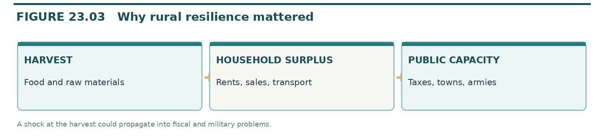

A castle, cathedral and royal army required surplus food, clothing, timber, metal and transport. Most medieval people lived in rural communities, although the proportion changed across regions and centuries. Farmers worked plots under mixtures of ownership, tenancy and obligation. Households used animals for ploughing and traction, managed pastures and woodlands, and adapted to local rainfall, soil and growing seasons. Noble property rights could be powerful, but villages sometimes regulated shared fields, grazing and resource use through collective custom.

Avoid imagining every peasant as equally poor or powerless. Some households held considerable land, hired workers or lent grain; others faced insecurity, forced labor, rents and sudden levies. Women's labor was central to production, food processing, textile work, markets and family survival, though legal opportunities and inheritance rights differed sharply. Children worked and learned within households and trades, while migration and marriage tied villages to wider economies. Lords and monasteries might keep detailed rental records, but those accounts frequently measure obligations better than emotions or actual living standards.

Agricultural change was cumulative. In suitable regions, improved harnesses, mills, crop rotations, drainage and expanding settlement contributed to greater output. Population growth before the fourteenth century placed pressure on marginal lands and made communities vulnerable when harvests failed. A failed crop could reduce food, increase debt, undermine tax revenue and make disease more dangerous. The lesson is systemic: political power rested on the productive capacity and resilience of households whose names rarely appear in royal chronicles.

<figure class="figure" id="figure-23-3">

<figcaption>Figure 23.3. A shock at the harvest could propagate into fiscal and military problems. <a class="figure-anchor" href="#figure-23-3" aria-label="Link to this figure">#</a></figcaption>
</figure>
