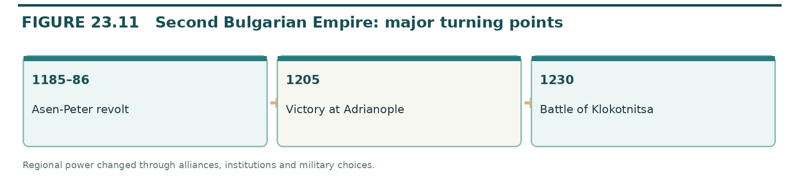

In 1185–86 an uprising associated with the brothers Peter and Asen led to the re-establishment of an independent Bulgarian polity, conventionally called the Second Bulgarian Empire. Its center at Tarnovo became a major political and cultural capital. This restoration did not simply revive every institution of the First Bulgarian Empire unchanged. The rulers operated in a landscape of Byzantine weakness, regional aristocratic interests, Cuman alliances, Latin crusading states and competing Balkan powers. Political titles, church recognition and marriage alliances could be as important as battlefield victories.

Kaloyan, a ruler from the Asen dynasty, achieved a dramatic victory over forces of the new Latin Empire at Adrianople in 1205, where the Latin emperor Baldwin I was captured. The event demonstrates that the sack of Constantinople did not grant western crusaders unchallenged control of the Balkans. Under Ivan Asen II, who ruled from 1218 to 1241, Bulgarian power expanded through a combination of diplomacy and military success. The battle of Klokotnitsa in 1230 became a landmark in the kingdom's regional rise. Yet political reach should not be mistaken for uniform occupation: influence, tributary relationships and direct administration were different forms of power.

Later rulers confronted aristocratic competition, Mongol influence and regional fragmentation. Bulgarian political history in these centuries involved negotiation with Byzantium, Serbian rulers, steppe powers and the Latin world. Its importance is not merely national pride. Tarnovo shows how a state situated between major imperial systems could create its own diplomatic agenda, religious institutions and distinctive artistic life while remaining exposed to the same structural pressures that troubled its neighbors.

<figure class="figure" id="figure-23-11">

<figcaption>Figure 23.11. Regional power changed through alliances, institutions and military choices. <a class="figure-anchor" href="#figure-23-11" aria-label="Link to this figure">#</a></figcaption>
</figure>
