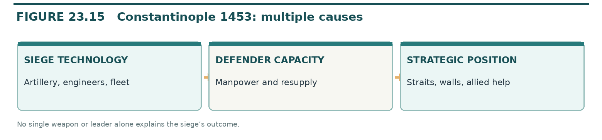

In April 1453 the young Sultan Mehmed II began a concerted siege of Constantinople. The city occupied a strategic position between the Black Sea and Mediterranean worlds, with formidable land walls and defenses around the Golden Horn. Mehmed's forces included artillery, naval power, engineers, infantry and commanders coordinating prolonged pressure. The Byzantine defenders, led by Constantine XI and joined by foreign allies including Genoese troops, faced shortages of manpower and resources. The siege ended on 29 May 1453 when Ottoman troops entered the city and the last Byzantine emperor died during its defense.

Large bombards and other artillery contributed to the siege, but the popular image of one cannon instantly shattering an otherwise impregnable world is misleading. The city's reduced resources, sustained attacks, repair efforts, the struggle over sea access and the limited ability of outside rulers to intervene all mattered. Contemporary and near-contemporary narratives give differing accounts of particular assaults and heroism. We should not promote every anecdote about a gate, omen or last speech into fact. The conquest also involved suffering and plunder, alongside the new ruler's efforts to establish and populate an imperial capital.

In one sense 1453 was an ending: Constantinople ceased to be the capital of an independent Roman-Byzantine emperor. In another sense it was a transformation. The Ottomans made the city their capital and continued to use, repurpose and preserve selected elements of its urban and administrative inheritance. Byzantine art, Orthodox institutions, scholarship and political ideas continued elsewhere, including in Balkan and eastern Christian societies and in contacts with Italian centers. The fall did not mechanically cause the Renaissance, close every eastern trade route or mark the instant birth of modernity. It changed the balance of power in ways whose consequences depended on choices made afterward.

<figure class="figure" id="figure-23-15">

<figcaption>Figure 23.15. No single weapon or leader alone explains the siege’s outcome. <a class="figure-anchor" href="#figure-23-15" aria-label="Link to this figure">#</a></figcaption>
</figure>
