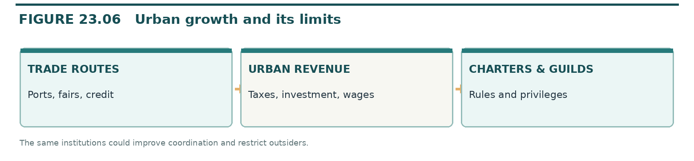

Medieval towns were not all revived Roman cities. Some grew around ports, fortified centers, pilgrimage destinations, mining districts or trading fairs. Commercial expansion connected Flemish cloth production, English wool, northern Italian finance, Baltic timber and grain, Mediterranean shipping and inland markets. Venice and Genoa built far-reaching maritime networks, while the Hanseatic League organized cooperation and privilege among northern merchants and towns. Those connections intersected with the Silk Roads and Indian Ocean systems studied in Chapter 21, although political borders and customs charges made exchange costly.

Urban residents negotiated charters and exemptions from some lordly obligations. Guilds and other craft organizations could regulate training, quality, membership, mutual aid and access to markets. Their purpose was not always simply consumer protection; they could also restrict competition and defend insiders. Merchants required trusted credit, records and ways of enforcing bargains over distances they could not personally supervise. Religion, kinship, reputation and law all helped them manage risk, while fraud and conflict were never absent.

Growth brought new inequality. A prosperous merchant house and a precarious casual laborer might live in the same walled city. Famine and epidemic could travel through commercial connections. Yet towns mattered politically because taxable wealth and organized citizens gave rulers new partners and rivals. Ask whether a particular urban institution increased opportunity for some people by excluding others. The answer changes from town to town and prevents us from romanticizing either markets or guilds.

<figure class="figure" id="figure-23-6">

<figcaption>Figure 23.6. The same institutions could improve coordination and restrict outsiders. <a class="figure-anchor" href="#figure-23-6" aria-label="Link to this figure">#</a></figcaption>
</figure>
