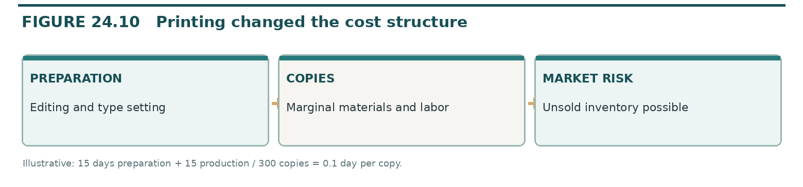

A hypothetical comparison makes the scale effect tangible. Suppose a skilled scribe needs 20 working days to copy and check one long text. Ten scribes working in parallel could complete ten copies in roughly 20 days, ignoring different speeds and preparation. Now imagine a printing shop that first spends 15 days preparing type and proofs and then produces 300 usable copies over 15 further working days. This simplified scenario suggests that large print runs can spread fixed preparation costs across many books. It does not establish how fast any real fifteenth-century press operated. Such rates depended on page size, complexity, available type, worker organization, paper and demand.

We can express the contrast more carefully. For a manuscript, many labor costs recur for every additional copy. For a printed edition, preparing type and illustrations is a relatively large initial expense, while additional copies have smaller marginal costs until equipment or materials become constraints. If demand is weak, the printer may lose money on unsold stock. Printing is not always cheaper for a one-off document. Thus market size and anticipated sales are as important as the technology.

The apparent gain in copying efficiency did not imply that all books instantly became affordable to every family. Literacy, language, price, time, access to sellers and social permission shaped audiences. Shared reading, recitation and preaching could extend influence beyond individual book ownership. Economically, the relevant innovation was not that one machine replaced every scribe; it was that new combinations of fixed costs, repeatability and distribution changed the possibilities for producing and circulating texts. \[<a href="/024-renaissance-humanism-and-printing/sources/#source-24" class="cite">24</a>\]

<figure class="figure" id="figure-24-10">

<figcaption>Figure 24.10. Illustrative: 15 days preparation + 15 production / 300 copies = 0.1 day per copy. <a class="figure-anchor" href="#figure-24-10" aria-label="Link to this figure">#</a></figcaption>
</figure>
