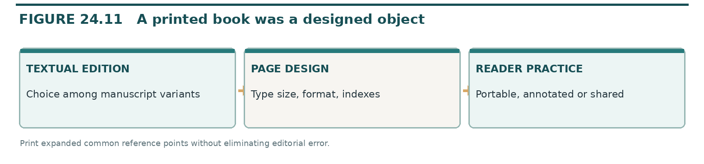

The Venetian printer Aldus Manutius, active in the late fifteenth and early sixteenth centuries, became associated with carefully edited editions of classical texts, Greek typography and compact book formats. His Aldine editions illustrate how technical and commercial choices could serve a scholarly vision. A smaller volume was easier for some readers to carry and consult than a massive desk book, although portable did not automatically mean cheap or available to every social class. Aldus's publishing program drew on editors, type designers, financiers and the international demand for Greek and Latin learning. \[<a href="/024-renaissance-humanism-and-printing/sources/#source-26" class="cite">26</a>\]

A printer could change scholarship not by generating original arguments but by producing a shared text for distant readers. Scholars who owned the same edition could cite passages, compare errors and exchange corrections. Yet publishers might choose among rival manuscript traditions, deciding what counted as the authoritative wording. Once reproduced widely, those decisions could become difficult to challenge. Printing multiplied both good scholarship and editorial mistakes.

The Aldine press also reminds us that design itself is historical evidence. Page dimensions, typeface, margins, punctuation and the arrangement of an index tell us how producers expected readers to use a book. A beautifully made edition can support close reading; it can also signal status. Modern readers who assume that information exists apart from its medium overlook how the physical form of books affects navigation, ownership and the social identity of readers. \[<a href="/024-renaissance-humanism-and-printing/sources/#source-24" class="cite">24</a>\]\[<a href="/024-renaissance-humanism-and-printing/sources/#source-26" class="cite">26</a>\]

<figure class="figure" id="figure-24-11">

<figcaption>Figure 24.11. Print expanded common reference points without eliminating editorial error. <a class="figure-anchor" href="#figure-24-11" aria-label="Link to this figure">#</a></figcaption>
</figure>
