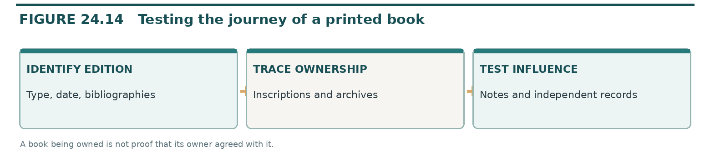

Imagine that a historian discovers a Latin edition of Cicero printed in Venice around 1500, later owned by a teacher in a northern town. The title page and typeface suggest a printer, a handwritten inscription names a possible owner, and marginal notes discuss disputed passages. A library catalogue from the sixteenth century records a book with a similar title. This is a hypothetical exercise, not a description of a particular surviving copy. The evidence presents an appealing story: an Italian humanist edition travelled north and changed a teacher's thinking. What would establish each part?

First, identify the edition by comparing type, collation and bibliographical records. Second, establish whether the inscription belongs to the period and whether the named teacher can be independently identified. Third, examine notes for dates, references or evidence of actual reading. Fourth, distinguish circulation from influence. Ownership proves that a book reached a collection; it does not prove that the owner agreed with its contents or taught from it. If another copy survives, compare variants, binding and annotations to investigate different readers' experiences.

This small study captures the methods of the chapter: material evidence, language, provenance, economic networks and uncertainty. A beautifully printed book may be culturally important even if we cannot reconstruct every reader. Conversely, a broad claim that printing caused a particular political event requires evidence beyond the existence of printed pages. The correct conclusion is proportional to the evidence available. The work of an intellectual historian resembles the work of a detective who must understand both the object and the institutions that allowed it to travel.

<figure class="figure" id="figure-24-14">

<figcaption>Figure 24.14. A book being owned is not proof that its owner agreed with it. <a class="figure-anchor" href="#figure-24-14" aria-label="Link to this figure">#</a></figcaption>
</figure>
