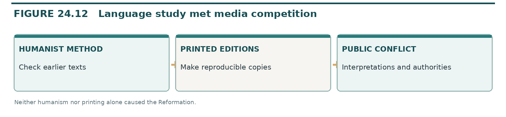

Desiderius Erasmus of Rotterdam (c. 1466–1536) combined classical language study with Christian moral criticism. He encouraged attention to the sources of Christian tradition, questioned some practices and used satire to expose pretension. In 1516 a Greek text of the New Testament appeared in print with Erasmus's new Latin translation. This was a significant event in scholarly and religious history, though neither Erasmus's edition nor his methodology was beyond criticism. The choice of manuscripts, translation decisions and later revised editions became matters for discussion. \[<a href="/024-renaissance-humanism-and-printing/sources/#source-29" class="cite">29</a>\]

The program often described as ad fontes—back to the sources—meant returning to early texts and learning the languages necessary to examine them. It could support traditional devotion, institutional reform or disputes that went further than the original scholar intended. To imagine humanists as uniformly anti-church would be inaccurate: many sought to strengthen Christian life through education and criticism. Nor did every opponent of church abuses agree about doctrine or political action.

Printing amplified these arguments by making scholarly editions, popular religious texts and criticism easier to reproduce. But the Reformation of the sixteenth century also depended on rulers, clergy, urban communities, theological disagreement and disputes about authority. Chapter 25 will examine those conflicts in their own right. Here we should retain a narrower lesson: Renaissance textual techniques altered the terms on which religious claims could be defended or challenged, while the printed page did not decide which interpretation was true. \[<a href="/024-renaissance-humanism-and-printing/sources/#source-27" class="cite">27</a>\]\[<a href="/024-renaissance-humanism-and-printing/sources/#source-29" class="cite">29</a>\]

<figure class="figure" id="figure-24-12">

<figcaption>Figure 24.12. Neither humanism nor printing alone caused the Reformation. <a class="figure-anchor" href="#figure-24-12" aria-label="Link to this figure">#</a></figcaption>
</figure>
