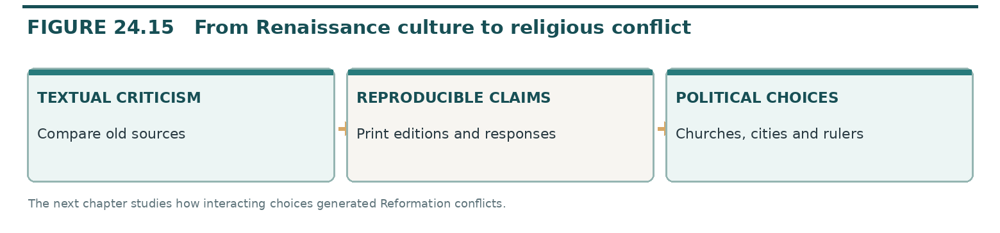

Return to the imaginary Florentine visitor from the beginning. The manuscripts have not disappeared; some are now being edited and printed. The painters still negotiate with patrons; several techniques have become teachable models. Merchants continue to finance enterprises, including the new business of book production. Clergy, princes and scholars read competing versions of important texts. The changes are substantial, yet none has abolished older institutions or produced universal agreement.

A central connection now comes into view. Humanist language study allowed scholars to examine inherited religious and political claims more critically. Printing made it easier to reproduce editions, criticisms, illustrations and replies. Political and religious institutions sought to use or regulate these channels. The combination did not determine which ideas would triumph; it multiplied opportunities for both persuasion and conflict. Individuals who shared the goal of Christian renewal could disagree profoundly about methods, authority and the meaning of scripture.

Chapter 25, the Reformation and Religious Conflict, will follow those disagreements into churches, households, royal courts and battlefields. Our approach will not assume that printing alone created the Reformation or that Renaissance humanists uniformly advocated it. The lesson of Chapter 24 is more demanding: understand cultural change as a network of knowledge practices, resources, incentives and institutions. A renaissance is not a light switched on after darkness. It is a contested process by which people reinterpreted the inheritance they already possessed and built new means of circulating it.

<figure class="figure" id="figure-24-15">

<figcaption>Figure 24.15. The next chapter studies how interacting choices generated Reformation conflicts. <a class="figure-anchor" href="#figure-24-15" aria-label="Link to this figure">#</a></figcaption>
</figure>
