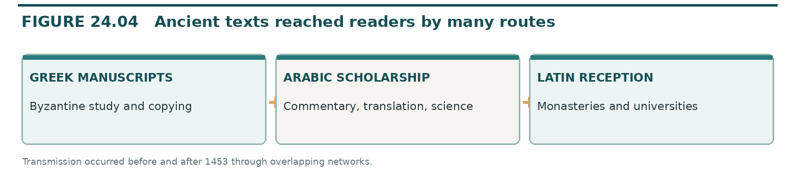

Greek-language learning in western Europe expanded through sustained contact with the Byzantine world. Teachers such as Manuel Chrysoloras taught Greek in Italy around the turn of the fifteenth century, and scholars attended church councils, pursued diplomatic missions and exchanged manuscripts across the Adriatic. After 1453, additional Greek-speaking scholars migrated or worked under new political circumstances. Yet these migrations continued a long history of exchange and should not be treated as the sudden delivery of civilization to an otherwise empty intellectual landscape.

The ancient sources reached Europe by more than one route. Classical Greek and Roman texts existed in Byzantine collections and Latin monasteries; Arabic and Persian scholarly traditions had preserved, criticized and extended works in philosophy, astronomy, medicine and mathematics. Translation into Latin had flourished in preceding centuries, notably in multicultural zones of contact. Renaissance scholars sometimes returned to Greek originals to check earlier versions, but a return to an original text did not mean that translators and commentators in other languages had contributed nothing.

Trade and political relations also linked Italian cities to Ottoman ports and other eastern Mediterranean societies. Hostility and cultural exchange could coexist: merchants might negotiate licenses and freight while rulers competed militarily. When discussing the intellectual inheritance of the Renaissance, trace each book's chain of copying, translating, shipping, teaching and printing. 'Greek knowledge reached Italy' is an incomplete sentence unless we explain who preserved it, who transmitted it, who could read it and who paid for that work. \[<a href="/024-renaissance-humanism-and-printing/sources/#source-4" class="cite">4</a>\]\[<a href="/024-renaissance-humanism-and-printing/sources/#source-10" class="cite">10</a>\]

<figure class="figure" id="figure-24-4">

<figcaption>Figure 24.4. Transmission occurred before and after 1453 through overlapping networks. <a class="figure-anchor" href="#figure-24-4" aria-label="Link to this figure">#</a></figcaption>
</figure>
