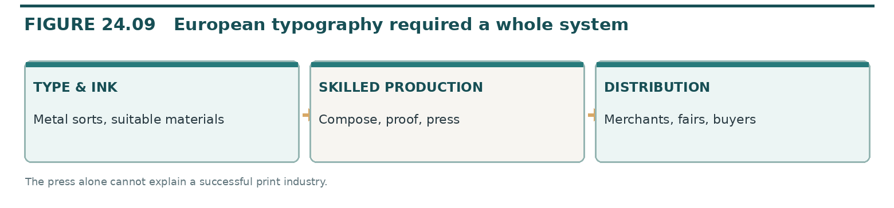

In mid-fifteenth-century Mainz, Johannes Gutenberg and collaborators developed a highly effective European system of typographic printing. Uniform metal letters could be produced and assembled into lines, combined with printing ink suited to the process, and pressed repeatedly against paper or parchment. Compositors could rearrange the type for the next page. A press was only one element of this enterprise. The technical breakthrough lay in integrating type production, composition, ink, pressure, skilled labor and financing into a reproducible workflow. \[<a href="/024-renaissance-humanism-and-printing/sources/#source-23" class="cite">23</a>\]

The famous Gutenberg Bible, a large Latin Bible generally dated to about 1454–1455, showed the ambition of the new process. Its pages, usually arranged in two columns with forty-two lines, consciously resembled elegant manuscripts. That resemblance is instructive: early printers initially sold books to readers familiar with manuscript conventions, not to a public yearning for entirely new-looking media. Hand decoration was sometimes added after printing. Exact details of workshop arrangements and responsibilities can be difficult to reconstruct, particularly because legal and business disputes shaped the surviving evidence.

Gutenberg did not personally initiate the entire European book trade or single-handedly invent each component. Printers, investors, metalworkers, papermakers, editors and booksellers expanded the system across cities. Financial risk remained high: type, materials and skilled workers required investment before sales began. The rapid spread of presses resulted from technical effectiveness combined with labor mobility, urban markets and demand from churches, universities, courts and merchants. A machine matters historically when a network of institutions makes it useful at scale.

<figure class="figure" id="figure-24-9">

<figcaption>Figure 24.9. The press alone cannot explain a successful print industry. <a class="figure-anchor" href="#figure-24-9" aria-label="Link to this figure">#</a></figcaption>
</figure>
