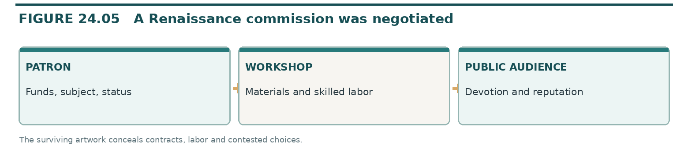

Renaissance art flourished through patronage, a relationship in which individuals or institutions paid for objects, performances, buildings or scholarly work. A patron might be a merchant, guild, bishop, religious order, prince or civic government. The commission could establish materials, subject matter, delivery date, costs and expectations of quality. Patrons often cared deeply about Christian devotion and the memory of family members; others wanted to display cultural sophistication or political power. Artists brought their own professional ambitions, training and workshop practices to the bargain.

A masterpiece was often a collective product. Workshops trained apprentices, prepared surfaces, mixed colors, carved frames and sometimes contributed extensive painted passages. Individual attribution can be complicated when a master designed a work but assistants executed much of it. Surviving contracts, account books and technical examinations help historians reconstruct these processes. Nor was creative freedom unlimited. Painters could be asked to include specific saints, recognizable donors or expensive ultramarine pigment. Negotiation over price and prestige shaped what viewers eventually saw.

There was a feedback loop. Successful artists attracted wealthy patrons; visible commissions enhanced patrons' reputations; training and rivalry encouraged technical innovation; competitors sought work in neighboring cities. But there was also risk. A ruler's political downfall could interrupt commissions, while a workshop might fail financially despite producing excellent art. Treat cultural production as a labor market embedded in unequal social institutions, not a spontaneous outpouring by individuals detached from money and power. \[<a href="/024-renaissance-humanism-and-printing/sources/#source-5" class="cite">5</a>\]\[<a href="/024-renaissance-humanism-and-printing/sources/#source-7" class="cite">7</a>\]

<figure class="figure" id="figure-24-5">

<figcaption>Figure 24.5. The surviving artwork conceals contracts, labor and contested choices. <a class="figure-anchor" href="#figure-24-5" aria-label="Link to this figure">#</a></figcaption>
</figure>
