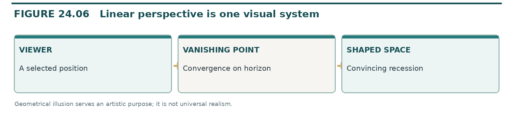

One of the most influential developments in Italian Renaissance painting was the increasingly systematic use of linear perspective. Objects represented as farther away can be made smaller; parallel lines receding in a constructed scene can be organized toward a vanishing point on a horizon. The technique did not invent the observation that distant things appear smaller, and it was never the only way artists represented space. Earlier painters in different societies had developed sophisticated spatial conventions. The distinctive Renaissance achievement was to formalize certain geometrical methods and turn them into influential teaching tools.

The painter Masaccio's early fifteenth-century frescoes are celebrated for convincing bodily weight and spatial illusion, while Leon Battista Alberti's treatise on painting articulated a systematic framework. Perspective was not simply a mathematical decoration; it affected where the viewer seemed to stand relative to an image. Its success depended on viewpoint and artistic choice. A sacred scene could invite worshippers to imagine an extension of the chapel itself, or a patron might use controlled geometry to convey mastery and order.

Observe two paintings of a city: one uses a bird's-eye schematic to show all important buildings; the other shows a street from a single imagined position. The first may serve orientation and symbolic hierarchy better, while the second creates optical consistency. Calling the first inaccurate assumes both pictures share the same aim. Perspective is a technique for particular representational purposes, not a universal ranking of artistic merit. The valuable habit is to identify the rules of the image and ask what they enable or conceal. \[<a href="/024-renaissance-humanism-and-printing/sources/#source-13" class="cite">13</a>\]

<figure class="figure" id="figure-24-6">

<figcaption>Figure 24.6. Geometrical illusion serves an artistic purpose; it is not universal realism. <a class="figure-anchor" href="#figure-24-6" aria-label="Link to this figure">#</a></figcaption>
</figure>
