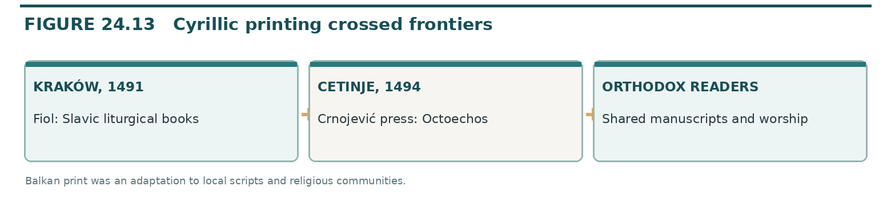

Latin remained an important common language of European scholarship, but printed books also appeared in many vernacular languages. Readers of Italian, German, French, English, Spanish and other tongues could encounter texts not restricted to highly educated Latin specialists. A book's language shaped its potential market and the communities that could claim it as their own. Yet language boundaries were porous. People read aloud to others, translated passages, and shared oral summaries. A book in a vernacular was not automatically a book for everyone.

Printing also depended on type suitable for particular scripts. A Latin alphabet shop could not necessarily produce Greek, Hebrew or Cyrillic editions without new fonts, expertise and expected buyers. Humanist printers invested in Greek type, and other workshops served Jewish, Orthodox Christian and different regional communities. Typography is thus a history of identity and technical choice. The design of letters, not just the content of texts, helps explain why certain markets expanded before others.

Early Cyrillic printing illustrates a more geographically connected story. Schweipolt Fiol's Slavic liturgical printing in Kraków is associated with 1491; in the 1490s the Crnojević printing enterprise in Cetinje produced Church Slavonic books, including an Octoechos dated 1494. These initiatives complicate an Italian-to-northwest-Europe story of print. Religious communities, local rulers, artisans and books crossed frontiers that did not match modern nation-states. For the Balkans, the new technology interacted with older manuscript practices and Orthodox worship rather than simply replacing them. \[<a href="/024-renaissance-humanism-and-printing/sources/#source-30" class="cite">30</a>\]

<figure class="figure" id="figure-24-13">

<figcaption>Figure 24.13. Balkan print was an adaptation to local scripts and religious communities. <a class="figure-anchor" href="#figure-24-13" aria-label="Link to this figure">#</a></figcaption>
</figure>
