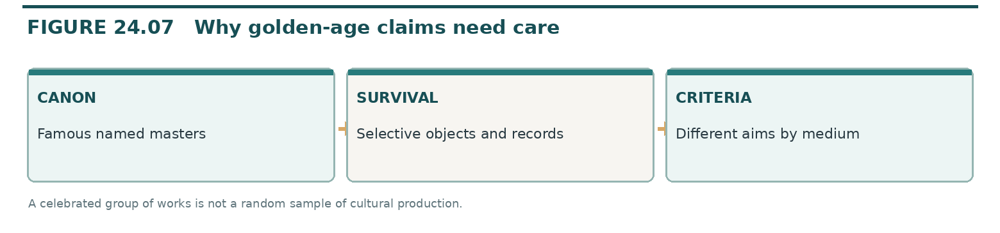

Art historians often use High Renaissance for exceptional developments in Rome, Florence and related centers around the late fifteenth and early sixteenth centuries. Leonardo's works, Michelangelo's sculpture and painting, and Raphael's compositions became touchstones for later generations. Their different achievements should not be flattened into one formula: the painter's handling of light, the sculptor's engagement with mass and the architect's design problems require distinct analysis. A period label helps organize comparison, not prove an objective peak that every artist before or after failed to reach.

Rome's artistic ascent depended heavily on papal patronage. Popes acted as religious leaders and powerful rulers with ambitions to transform the city and its institutions. Commissions could express theology, family status and competing claims to universal authority. The Vatican became a great site of cultural production, but the money, labor and political bargains behind the work also mattered. Praise of an artistic golden age should not conceal the fiscal pressures and conflicts of the Italian Wars or the tensions inside the Church.

The phrase golden age often tells us which works later collectors and schools chose to celebrate. It can obscure less fashionable media such as textiles, furniture, architecture, urban festivals or work by women and artisans. What survives in museums is not a random sample of everything people made. For evaluation, compare the stated artistic criteria, the social context and the survival of objects. We should recognize exceptional skill without pretending aesthetic judgment is a purely mechanical measure. \[<a href="/024-renaissance-humanism-and-printing/sources/#source-5" class="cite">5</a>\]\[<a href="/024-renaissance-humanism-and-printing/sources/#source-17" class="cite">17</a>\]

<figure class="figure" id="figure-24-7">

<figcaption>Figure 24.7. A celebrated group of works is not a random sample of cultural production. <a class="figure-anchor" href="#figure-24-7" aria-label="Link to this figure">#</a></figcaption>
</figure>
