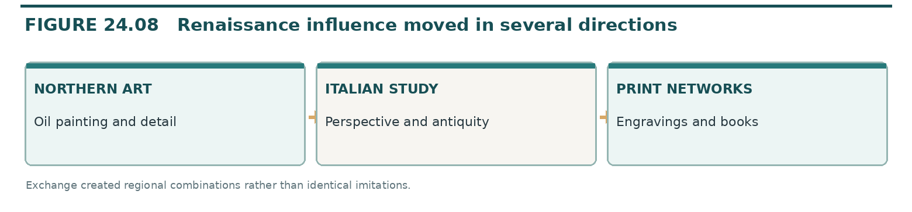

Renaissance cultural change crossed the Alps through travel, trade, dynastic households, ecclesiastical networks and printed books. In the Low Countries, artists such as Jan van Eyck and Rogier van der Weyden achieved striking optical detail through sophisticated work with pigments and oil-based techniques. These traditions cannot be reduced to Italian perspective arriving late. Netherlandish masters developed their own ways of rendering texture, reflected light and sacred presence, while patrons in northern towns and courts supported different genres and workshop systems.

In German-speaking lands, Albrecht Dürer studied Italian theories of proportion and perspective while becoming an extraordinary printmaker. His engravings and woodcuts circulated beyond the limited number of people who could see a single painting. This brings us to an important shift: an image could become a repeatable, tradeable object. Printmaking had its own earlier histories, but its expanding scale reshaped the economics of visual culture. Authorship, copying and artistic reputation took on new forms.

Northern humanism also placed strong emphasis on Christian learning and reform. Erasmus of Rotterdam and others pursued improvements in education, language and scriptural understanding. The word northern should not disguise differences among England, German territories, the Low Countries, France and Iberia. Nor should Italian culture be treated as the sole source of everything of value. The Renaissance was produced through exchanges among several regional traditions whose techniques, markets and institutions were not identical. \[<a href="/024-renaissance-humanism-and-printing/sources/#source-20" class="cite">20</a>\]\[<a href="/024-renaissance-humanism-and-printing/sources/#source-21" class="cite">21</a>\]

<figure class="figure" id="figure-24-8">

<figcaption>Figure 24.8. Exchange created regional combinations rather than identical imitations. <a class="figure-anchor" href="#figure-24-8" aria-label="Link to this figure">#</a></figcaption>
</figure>
