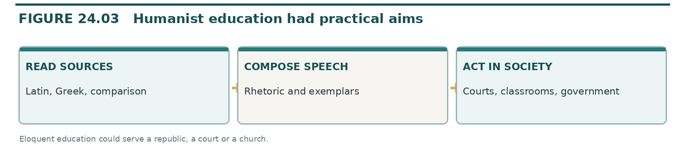

The studia humanitatis usually encompassed grammar, rhetoric, poetry, history and moral philosophy. It should not be understood as identical to a modern university humanities department or as a movement that invented the study of human beings. The humanist aim was to cultivate readers capable of distinguishing good Latin, interpreting historical examples, composing arguments and speaking persuasively in civic and courtly settings. Increasing attention to Greek broadened the corpus of ancient works accessible to some educated Italians.

A humanist class might examine a passage from Livy not only to translate its words but to ask how a Roman leader persuaded a crowd or why a republic declined. Students copied exemplary sentences, composed letters and practiced speeches. Learning could be demanding, socially exclusive and strongly oriented toward elite male careers. At the same time, the training created new habits of close comparison among texts and a larger market for reliable editions. Teachers and secretaries carried these techniques between towns and courts.

We should distinguish the ideal from the evidence of results. Training in Cicero did not guarantee a virtuous politician; neither did learning Greek make someone immune to prejudice. Rhetoric can illuminate problems or conceal them. Consider an imagined diplomatic letter praising a ruler as a new Augustus. Its classical vocabulary tells us about the writer's training and the political image the ruler wished to project, not whether the ruler actually governed like Augustus. The same skeptical reading used in Chapter 1 must apply to celebrated humanist sources. \[<a href="/024-renaissance-humanism-and-printing/sources/#source-2" class="cite">2</a>\]\[<a href="/024-renaissance-humanism-and-printing/sources/#source-8" class="cite">8</a>\]

<figure class="figure" id="figure-24-3">

<figcaption>Figure 24.3. Eloquent education could serve a republic, a court or a church. <a class="figure-anchor" href="#figure-24-3" aria-label="Link to this figure">#</a></figcaption>
</figure>
