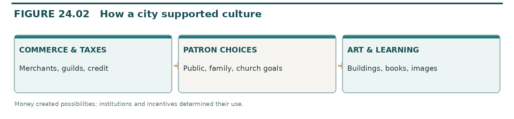

Italy was not a united country in the fifteenth century. Florence, Venice, Milan, Genoa, Naples, the Papal States and smaller courts competed, bargained and fought. Florence became associated with banking, wool production and politically influential merchant families; Venice maintained extensive Mediterranean trading networks; Milan became a powerful territorial state; Rome combined religious authority and princely patronage. Each polity followed a different path, and their rivalries could be violent. Nevertheless, concentrated wealth and urban institutions offered opportunities for education and commissions.

Commercial profits did not turn automatically into libraries or frescoes. Someone had to choose how to spend money: a guild could sponsor a building, an elite household could purchase manuscripts, a monastery could employ an artist, and a ruler could use a monument to advertise legitimacy. Wealth interacted with civic competition, personal devotion and the desire for enduring reputation. The same patron might finance a charitable institution, a family chapel and political propaganda. This is why a richly decorated Renaissance city can be evidence of both collective capacity and conspicuous inequality.

Urban public life also gave trained writers practical work. Chanceries required letters, negotiations, speeches, histories, treaties and appeals; lawyers and notaries needed clear expression and documentary expertise. Humanist command of Latin and historical examples could improve a man's reputation for public service. But city republicanism was not universal, and aristocratic households could purchase influence. Florence itself repeatedly underwent political upheaval and Medici dominance. It is misleading to call the entire Renaissance a democratic awakening. The right question is how the institutions of particular cities made certain cultural skills valuable. \[<a href="/024-renaissance-humanism-and-printing/sources/#source-5" class="cite">5</a>\]\[<a href="/024-renaissance-humanism-and-printing/sources/#source-6" class="cite">6</a>\]

<figure class="figure" id="figure-24-2">

<figcaption>Figure 24.2. Money created possibilities; institutions and incentives determined their use. <a class="figure-anchor" href="#figure-24-2" aria-label="Link to this figure">#</a></figcaption>
</figure>
