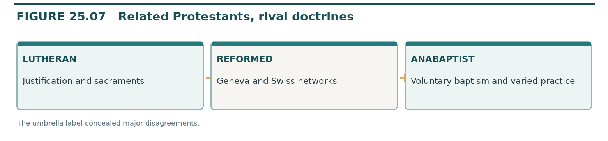

John Calvin, born in France in 1509, became one of the most influential Reformed theologians. His Institutes of the Christian Religion, first published in 1536 and repeatedly expanded, presented a systematic account of Christian teaching. Calvin's career in Geneva was politically complicated: he arrived in the city in 1536, was expelled in 1538, and returned in 1541. Reform depended on negotiations among pastors, magistrates, residents and institutions rather than on an all-powerful theologian personally commanding a city.

Geneva promoted structured ministry, instruction and moral discipline. Its consistory examined behavior, marriage disputes and religious practice, working within a civic order whose authority was contested. Calvin's teaching about divine providence and predestination became influential, but describing the city's system simply as a modern 'theocracy' hides the shifting boundaries between council and clergy. The execution of Michael Servetus for heresy in 1553 remains a clear example of lethal intolerance under Protestant civic rule. It cannot be dismissed as unimportant because other authorities also persecuted dissenters.

Geneva became a center for refugees, printers and ministerial training. Reformed networks reached France, the Netherlands, Scotland and parts of the Holy Roman Empire, while remaining locally diverse. The circulation of clergy and books mattered as much as one city's legislation. Calvin's influence demonstrates how a compact intellectual and institutional center can have far-reaching effects when it trains people, prints texts and offers refuge to migrants. It also illustrates the moral contradiction of insisting on reform of conscience while using public power to suppress rival religious convictions. \[<a href="/025-reformation-and-religious-conflict/sources/#source-12" class="cite">12</a>\]\[<a href="/025-reformation-and-religious-conflict/sources/#source-13" class="cite">13</a>\]

<figure class="figure" id="figure-25-7">

<figcaption>Figure 25.7. The umbrella label concealed major disagreements. <a class="figure-anchor" href="#figure-25-7" aria-label="Link to this figure">#</a></figcaption>
</figure>
