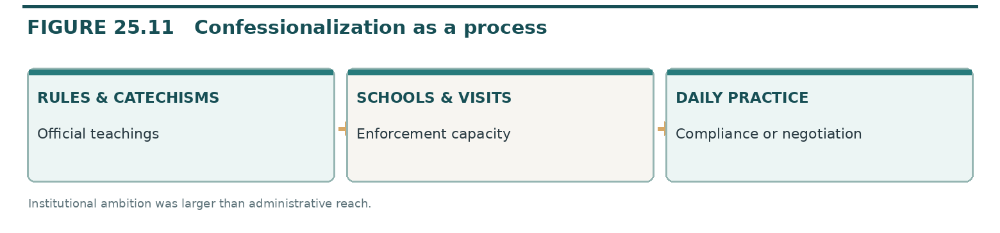

By the later sixteenth century, many rulers and church authorities tried to organize their territories around an officially favored confession. This process is sometimes called confessionalization: religious instruction, marriage regulation, schooling, inspection of clergy, censuses, church courts and moral discipline could be coordinated with the growth of territorial government. Lutheran, Reformed and Catholic regimes all developed tools of supervision, although not in identical forms or with equal effectiveness.

The term is useful because it connects religion to institutions rather than treating doctrine as a set of isolated ideas. If a government wants parish children to know a catechism, it needs schools or regular instruction; if it wants clergy to follow rules, it needs visits, records and means of enforcement. That creates administrative activity and new information about subjects. Yet historians disagree over how closely churches and states worked together, how much ordinary people internalized official beliefs, and whether a single European model obscures regional differences.

A town's records might report a campaign against public drunkenness, unauthorized festivities or attendance at another confession's worship. Those records show an authority's priorities, not necessarily successful reform. Citizens could evade rules, negotiate exceptions, continue older rituals privately or find local officials sympathetic to their practices. The comparison resembles systems thinking: more surveillance can increase compliance, but it can also produce resistance, concealment and expensive enforcement. Confessionalization is a hypothesis about an institutional pattern, not proof that religion everywhere became mechanically controlled by the state. \[<a href="/025-reformation-and-religious-conflict/sources/#source-1" class="cite">1</a>\]\[<a href="/025-reformation-and-religious-conflict/sources/#source-2" class="cite">2</a>\]

<figure class="figure" id="figure-25-11">

<figcaption>Figure 25.11. Institutional ambition was larger than administrative reach. <a class="figure-anchor" href="#figure-25-11" aria-label="Link to this figure">#</a></figcaption>
</figure>
